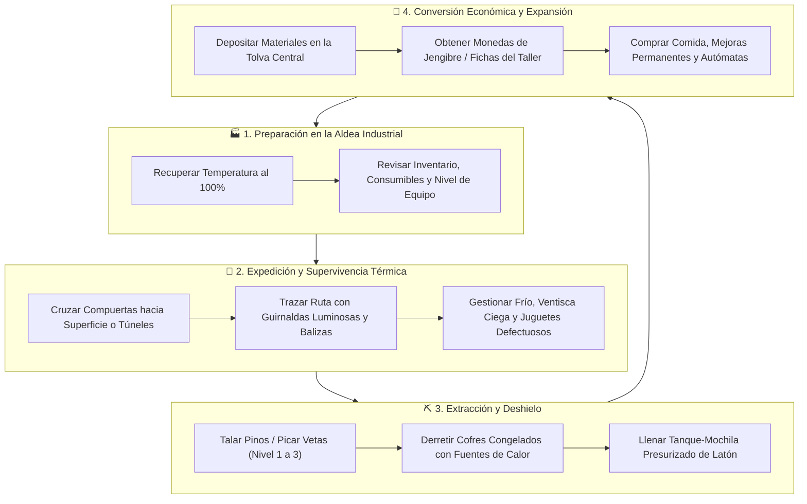

# Bucle Principal de Jugabilidad (Core Gameplay Loop)

---

## 1. Diagrama del Bucle Jugable

---

## 2. Escalas del Bucle Jugable

### 2.1. Micro-Bucle (Cada 1 a 3 minutos)
* **Acción:** Avanzar entre dos nodos de luz, evaluar el medidor de calor corporal en el tanque-mochila, colocar una **Guirnalda Luminosa** para crear una burbuja segura, extraer una veta mineral con el **Pico de Cristal Energético** y defenderse de un **Soldado de Juguete Defectuoso**.
* **Recompensa inmediata:** Minerales en el inventario y ruta iluminada permanente.

### 2.2. Medio-Bucle (Cada Ciclo de 20 minutos — 1 Día/Noche Polar)
* **Acción:** Aprovechar los **10 minutos de luz diurna** para explorar zonas lejanas de superficie (*Bosque de Caramelos* o *Cementerio de Trineos*), derretir un cofre congelado y regresar a la aldea o refugio subterráneo antes de que los **10 minutos de noche polar** desaten una **Ventisca Ciega**.
* **Recompensa media:** Descarga masiva en la **Tolva Central**, obtención de **Monedas de Jengibre** y compra de una mejora permanente o tramo de cinta transportadora.

### 2.3. Macro-Bucle (Campaña de 20 Horas — 60 Ciclos)
* **Acción:** Desbloquear los 3 niveles de equipamiento del Duende Ingeniero, automatizar las vetas de Nivel 1 y 2 con **Duendes Mecánicos**, perforar hasta **El Abismo del Núcleo Luminoso (Nivel 3)** y superar la sobrecarga final durante **La Gran Nochebuena**.
