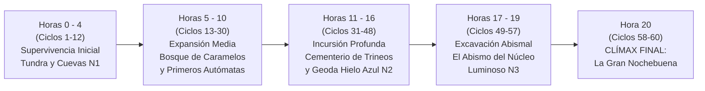

# Cronología y Estructura de la Campaña de 20 Horas

---

## 1. Coherencia Temporal: Una Sola Campaña Invernal

A diferencia de otros juegos que dividen su historia en años o niveles desconectados, toda la aventura de **BOREATEK** transcurre de manera continua durante **una sola campaña invernal** previa a la Navidad:

* **Duración de 1 Día Completo en Boreatek:** `20 minutos` en tiempo real (`1,200 segundos`).
  * **10 Minutos de Día Ártico:** El sol polar se mantiene cerca del horizonte ofreciendo visibilidad media-alta y temperaturas manejables para expandir la red en superficie.
  * **10 Minutos de Noche Polar:** Oscuridad iluminada por auroras boreales, descenso brusco de temperatura, mayor agresividad de los autómatas defectuosos y alta probabilidad de **Ventisca Ciega**.
* **Duración Total de la Campaña:** `20 horas` de partida (`60 ciclos completos` de 20 minutos).

---

## 2. Progresión por Etapas a lo Largo de las 20 Horas

### Etapa 1: Establecimiento del Perímetro (Horas 0 a 4)
* El jugador aprende a gestionar su temperatura corporal saliendo a la **Tundra Exterior Inicial**.
* Tala **Pinos Cristalizados**, rescata chatarra de los primeros trineos cercanos, tiende sus primeras líneas de **Guirnaldas Luminosas** en los **Túneles de Ventilación** y extrae Carbón Negro y Hierro Polar inicial en las **Cuevas de Nivel 1**.

### Etapa 2: Industrialización Energética (Horas 5 a 10)
* Con el abrigo y el tanque-mochila mejorados a Nivel 2, el jugador establece rutas térmicas hacia el **Bosque de Caramelos Gigantes** para extraer grandes volúmenes de **Cristal de Caramelo**.
* Se instalan los primeros **Duendes Mecánicos Extractores** y **Cintas Transportadoras** para automatizar el flujo de Carbón y Cristal hacia la Tolva Central.

### Etapa 3: Expediciones de Alto Riesgo (Horas 11 a 16)
* Incursiones en **El Cementerio de Trineos** utilizando el *Radar de Regalos* y *Balizas Térmicas* para derretir **Cofres Congelados** mientras se repele a los **Soldados de Juguete Defectuosos**.
* Perforación de **La Geoda de Hielo Azul (Nivel 2)** mediante el *Pico Energético Nivel 2* y *Petardos Festivos* para obtener **Hielo Azul Profundo**.

### Etapa 4: La Falla Geotérmica (Horas 17 a 19)
* Descenso al tercer y último estrato: **El Abismo del Núcleo Luminoso (Nivel 3)**.
* Extracción de los **Núcleos Luminosos** sobre fisuras de magma festivo y optimización total de la red de cintas transportadoras.

### Etapa 5: El Evento Final — La Gran Nochebuena (Hora 20)
* Aterrizaje del **Trineo Blindado** en la Aldea Industrial.
* Todos los nodos entran en sobrecarga (`2x` recursos) bajo una **Ventisca Ciega** crítica, exigiendo que toda la infraestructura construida por el jugador opere a máxima capacidad para completar el despacho navideño.
