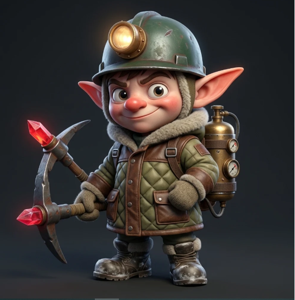
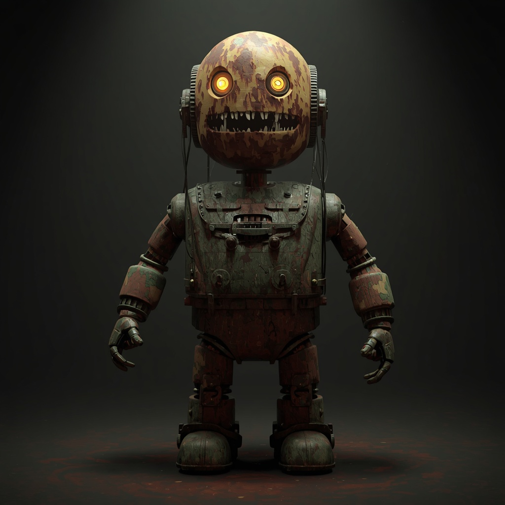

# Personajes y Bestiario de Entidades

> **Mapeo Oficial del Protagonista y Enemigos a Mecánicas Jugables y Equipamiento**

---

## 1. Protagonista: Duende Ingeniero / Minero (`concepto_duende_minero.png`)

* **Archivo Conceptual:** [`../02-art-bible/concept-art/personajes/concepto_duende_minero.png`](../02-art-bible/concept-art/personajes/concepto_duende_minero.png)

### 1.1. Rediseño Visual, Estilo 3D y Propiedad Intelectual
* **Coherencia con el Estilo 3D Estilizado del Juego:** El protagonista abandona cualquier aspecto oscuro o monstruoso para adoptar un diseño **3D estilizado y caricaturesco** con proporciones *chibi*/compactas, cabeza grande expresiva, ojos amplios, nariz rojiza y orejas puntiagudas prominentes, marcando el estándar visual exacto para el modelado dentro de Unity 3D.
* **Propiedad Intelectual 100 % Original:** Diseño creado específicamente para **BOREATEK**; sustituye el clásico gorro navideño de tela con cascabel por equipo industrial ártico pesado para evitar cualquier similitud con personajes externos.

### 1.2. Mapeo de Equipamiento Jugable (Visible en el Concepto)

| Pieza de Equipamiento | Nivel Inicial | Sistema en Código | Función Jugable y Progresión en Tienda |
| :--- | :---: | :--- | :--- |
| **1. Casco Minero Metálico con Faro Frontal** | Equipado desde el inicio | `PlayerController.cs` | Proyecta un cono de luz cálida (`Spot Light`) indispensable para explorar las cuevas oscuras y los túneles de ventilación. (Su haz de luz puede alertar a los enemigos cercanos). |
| **2. Abrigo Térmico Acolchado (Verde Oliva y Cuero con Forro de Borrego) + Botas de Nieve** | Nivel 1 (Base) | `TemperatureSystem.cs` | Representa el nivel base de protección contra el frío en la tundra exterior. Sus mejoras en tienda (Niveles 2 y 3) reducen la velocidad de congelamiento (`-25 %` y `-50 %`) y anulan la lentitud en nieve profunda. |
| **3. Tanque-Mochila Presurizado de Latón con Manómetros** | Nivel 1 (`10` ranuras) | `InventoryAndShop.cs` / `TemperatureSystem.cs` | Reemplaza la mochila simple; sus manómetros laterales funcionan como indicador visual del sistema térmico/energético y su cilindro define la capacidad máxima de carga de minerales (`10` ➔ `20` ➔ `35`) antes de volver a la tolva. |
| **4. Pico Industrial con Cristal Energético Rojo** | Nivel 1 (Base) | `HarvestableNode.cs` | Herramienta principal de extracción potenciada con puntas de **Cristal de Caramelo** rojo incandescente. Sus mejoras en el taller (Niveles 2 y 3) aumentan su eficiencia y permiten romper vetas duras como el *Hielo Azul Profundo* y los *Núcleos Luminosos*. |

---

## 2. Enemigo Principal: Soldado de Juguete Defectuoso (`concepto_juguete_de_plomo.jpg`)

* **Archivo Conceptual:** [`../02-art-bible/concept-art/personajes/concepto_juguete_de_plomo.jpg`](../02-art-bible/concept-art/personajes/concepto_juguete_de_plomo.jpg)
* *(Nota: En el juego final en Unity se modela con proporciones low-poly estilizadas coherentes con el protagonista, conservando su silueta cilíndrica oxidada, ojos circulares brillantes y cables sueltos).*

### 2.1. Características y Comportamiento Jugable
* **Descripción:** Autómata hostil desechado de tamaño humano, con armadura metálica verde y roja carcomida por el óxido, mandíbula dentada rígida, chispas eléctricas y ojos circulares ámbar.
* **Zonas de Aparición:** *El Cementerio de Trineos*, *Túneles de Ventilación* oscuros y *Cavernas de Nivel 1 y 2*.
* **Reglas de Detección e IA (`DefectiveToyAI.cs`):**
  * **Estado de Patrulla:** Camina pesadamente emitiendo sonidos de engranajes oxidados y chispas eléctricas visibles en la oscuridad.
  * **Detección Fototérmica:** Entra en estado agresivo al detectar el **Faro Frontal del Casco** del jugador, la activación de una **Baliza Térmica** (especialmente durante el deshielo de un Cofre Congelado) o el impacto del pico contra una veta cercana.
  * **Ataque y Contramedidas:** Ataca cuerpo a cuerpo reduciendo la salud del jugador. El jugador puede derribarlo con el **Pico de Cristal Energético**, distraerlo apagando el faro frontal tras una cobertura o recuperar salud con un **Bastón de Menta Curativo**.

---

## 3. Amenazas Secundarias del Entorno

### 3.1. Cascanueces Oxidados
* Variantes ligeras y veloces que merodean alrededor de los trineos estrellados en la superficie nocturna. Atacan en embestida lineal con sus mandíbulas mecánicas.

### 3.2. Gólems de Escarcha
* Colosos formados por bloques de hielo azul y chatarra polar que custodian los yacimientos de **La Geoda de Hielo Azul (Nivel 2)** y las entradas a **El Abismo del Núcleo Luminoso (Nivel 3)**.
* Su coraza glacial es inmune al pico básico; requieren utilizar **Petardos Festivos** o el **Pico Industrial Nivel 2/3** para fracturar su blindaje.

### 3.3. Lobos nivales

Patrullan la tundra y los alrededores del Cementerio de Trineos. Antes de embestir, se agachan y gruñen. El salto sigue la dirección que eligieron al impulsarse, lo que deja tiempo para apartarse de su trayectoria.

### 3.4. Polillas de escarcha

Vuelan entre los árboles de caramelo, en las planicies glaciares y en algunas cuevas procedurales. Se elevan y aceleran el aleteo antes de atacar en picada. Después se apartan para recuperar altura.

### 3.5. Escarabajos de cristal

Merodean en las morrenas, las planicies glaciares y las cámaras profundas de las cuevas. Se agachan antes de embestir en línea recta. El caparazón amortigua los golpes frontales. Puedes atacar por un costado, usar un petardo o golpear mientras recuperan el aliento tras una embestida.

### 3.6. Espectros de ventisca

Aparecen en la tundra y las crestas nevadas. Forman un cristal en el aire antes de lanzarlo hacia la posición en la que vieron al jugador. La descarga se puede esquivar y se rompe al chocar con una pared.

El pico, la espada y los petardos dañan a estas criaturas. Su salud se conserva al guardar la partida o al volver a su sector.
