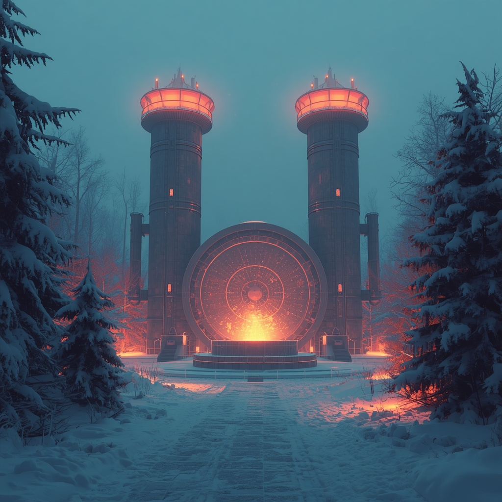
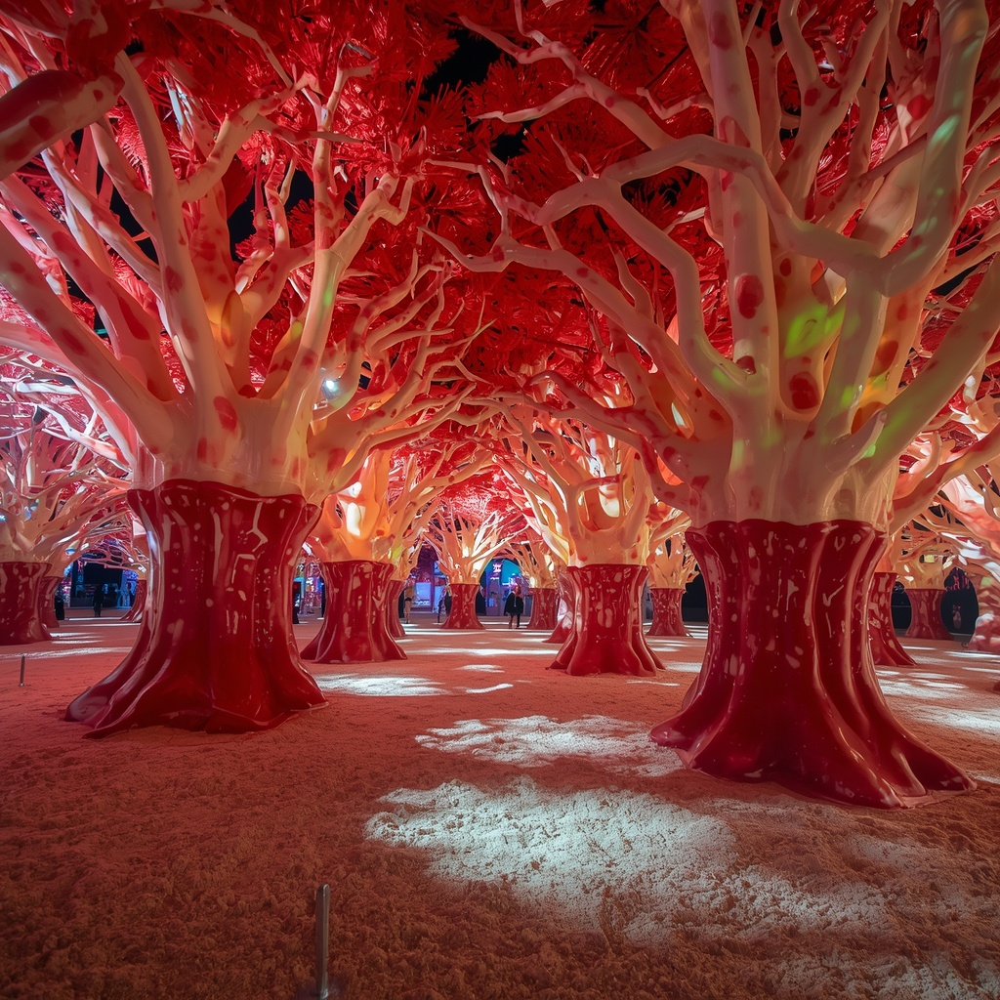
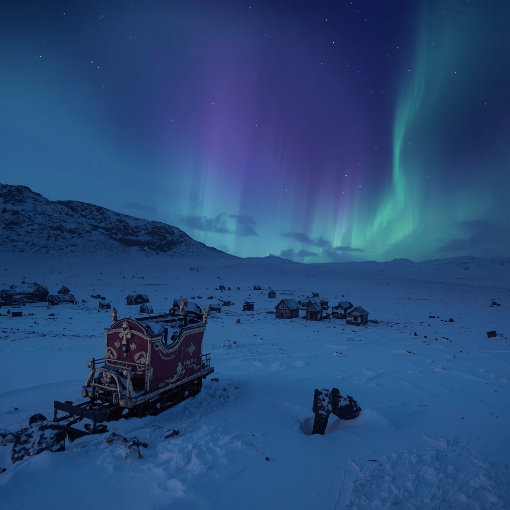
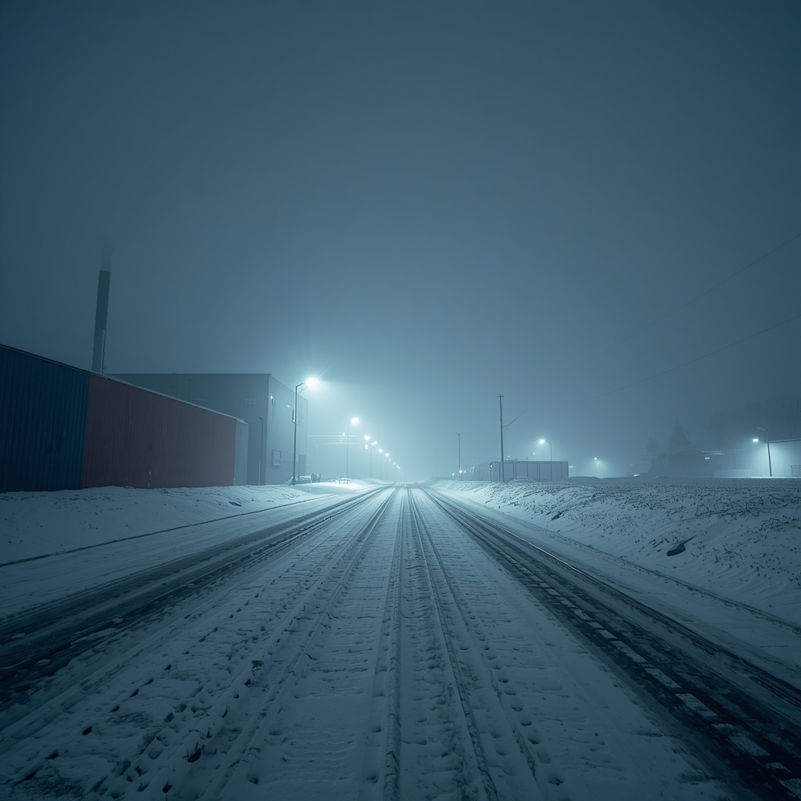

# Biomas de Superficie y Eventos Climáticos

> **Mapeo Oficial de Arte Conceptual de Superficie a Reglas y Mecánicas Jugables**  
> *(Nota: Las imágenes son referencias de composición, atmósfera e iluminación; en el juego se representan con estética 3D estilizada / low-poly).*

---

## 1. Aldea Industrial de Santa (`paisaje_nevado_futurista_industrial..jpg`)

* **Archivo Conceptual:** [`../02-art-bible/concept-art/paisajes/paisaje_nevado_futurista_industrial..jpg`](../02-art-bible/concept-art/paisajes/paisaje_nevado_futurista_industrial..jpg)
* **Composición y Atmósfera:** Zona segura base con arquitectura pesada de acero y cobre flanqueada por pinos nevados. Destacan sus dos torres gemelas con anillos superiores iluminados en rojo/ámbar y la monumental **Forja Central** circular a nivel del suelo.
* **Reglas Jugables y Mecánicas:**
  * **Zona Segura Térmica:** Dentro del radio de la aldea el jugador regenera calor corporal automáticamente (`+15 °T/s`) y está a salvo de las patrullas enemigas.
  * **Tolva Central:** Estructura receptora junto a la forja donde el jugador descarga los minerales de su tanque-mochila para obtener **Monedas de Jengibre / Fichas del Taller**.
  * **Tienda y Taller de Mejoras:** Terminal donde se adquieren consumibles térmicos, herramientas tácticas, mejoras permanentes de equipo y unidades de automatización.

---

## 2. Tundra Exterior Inicial (`tundra_helada_bajo_aurora_boreal.jpg`)

* **Archivo Conceptual:** [`../02-art-bible/concept-art/paisajes/tundra_helada_bajo_aurora_boreal.jpg`](../02-art-bible/concept-art/paisajes/tundra_helada_bajo_aurora_boreal.jpg)
* **Composición y Atmósfera:** Planicie ártica abierta bajo un cielo nocturno iluminado por una aurora boreal verde esmeralda, rodeada por una línea densa de pinos nevados y drones/trineos de reconocimiento caídos sobre la nieve.
* **Reglas Jugables y Mecánicas:**
  * **Bioma de Exploración Básica (Drenaje Térmico: `1.0 °T/s`):** Primera zona al cruzar las compuertas térmicas de la aldea.
  * **Recursos Extraíbles:**
    * **Pinos Cristalizados:** Se talan con herramientas de Nivel 1 para obtener madera densa estructural.
    * **Trineos Estrellados y Drones Caídos:** Proveen chatarra mecánica inicial y suministros básicos.

---

## 3. Bosque de Caramelos Gigantes (`bosque_surrealista_y_brillante.jpg`)

* **Archivo Conceptual:** [`../02-art-bible/concept-art/paisajes/bosque_surrealista_y_brillante.jpg`](../02-art-bible/concept-art/paisajes/bosque_surrealista_y_brillante.jpg)
* **Composición y Atmósfera:** Bioma surrealista y vibrante compuesto por formaciones arbóreas gigantescas de cristal de caramelo rojo y blanco que proyectan un resplandor cálido sobre el terreno helado.
* **Reglas Jugables y Mecánicas:**
  * **Bioma de Superficie de Nivel Medio (Drenaje Térmico: `1.5 °T/s`):** Requiere haber tendido una línea de guirnaldas luminosas desde la tundra para llegar con reserva térmica suficiente.
  * **Recurso Principal:** Fuente principal en superficie de **Cristal de Caramelo** (energía festiva de alto valor en la tolva y combustible para autómatas).

---

## 4. El Cementerio de Trineos (`paramo_desolado_de_nieve_profunda.jpg`)

* **Archivo Conceptual:** [`../02-art-bible/concept-art/paisajes/paramo_desolado_de_nieve_profunda.jpg`](../02-art-bible/concept-art/paisajes/paramo_desolado_de_nieve_profunda.jpg)
* **Composición y Atmósfera:** Páramo desolado de nieve profunda bajo auroras púrpuras y verdes, repleto de antiguos trineos rojos y dorados semienterrados y cabañas abandonadas al pie de las montañas.
* **Reglas Jugables y Mecánicas:**
  * **Zona Exterior Lejana de Alto Riesgo (Drenaje Térmico: `2.5 °T/s`):** La nieve profunda reduce un `25 %` la velocidad de movimiento a menos que el jugador mejore sus **Botas de Nieve**.
  * **Cofres Congelados:** Los trineos antiguos contienen cofres de alto valor bloqueados por hielo sólido. Para abrirlos es obligatorio **colocar una fuente de calor (Baliza Térmica) junto a ellos y esperar 15 segundos** a que se derritan.
  * **Peligros:** Patrullas activas de **Soldados de Juguete Defectuosos** y **Cascanueces Oxidados** que acudirán al detectar la luz y el calor de la baliza.

---

## 5. Evento Climático: Ventisca Ciega (`aldea_industrial_de_BOREATEK_bajo_ventisca.jpg`)

* **Archivo Conceptual:** [`../02-art-bible/concept-art/paisajes/aldea_industrial_de_BOREATEK_bajo_ventisca.jpg`](../02-art-bible/concept-art/paisajes/aldea_industrial_de_BOREATEK_bajo_ventisca.jpg)
* **Composición y Atmósfera:** Tormenta polar cerrada con niebla azul-grisácea espesa que oculta el horizonte y deja visibles únicamente los haces de luz de las farolas y guirnaldas a corta distancia.
* **Reglas Jugables y Mecánicas:**
  * **Estado Dinámico del Clima:** Gobernado por `DayNightCycleManager.cs`.
  * **Impacto en el Jugador:**
    * Incrementa la densidad de niebla en URP (`RenderSettings.fogDensity = 0.065`), reduciendo drásticamente el campo visual.
    * Aplica un **multiplicador de enfriamiento de `2.5x`** sobre la pérdida de temperatura corporal.
  * **Supervivencia:** Obliga al jugador a consumir un **Termo de Chocolate Caliente**, seguir las rutas de **Guirnaldas Luminosas** o resguardarse en los túneles subterráneos.

---

## 6. Frontera procedural de superficie

En Play Mode, el terreno exterior se genera en sectores de 64 × 64 metros conforme avanza el jugador. La malla utiliza coordenadas globales para calcular alturas compartidas en los bordes. Al cargar una partida o reaparecer, el sector de destino y sus ocho vecinos tienen suelo y colisión antes de habilitar el movimiento. Los demás sectores cercanos se generan por tandas y se descargan al quedar fuera del radio de retención.

La aldea, las ubicaciones originales de los recursos y las entradas a la mina conservan su distribución. Los tres estratos subterráneos siguen siendo finitos. Más allá de la región inicial se generan extensiones de tundra, bosques de caramelo y páramos de trineos con el mismo drenaje térmico de sus biomas equivalentes.

La semilla y las coordenadas reproducen la superficie y los recursos sin guardar cada malla. La versión 2 del guardado registra solo los cambios de recursos por sector e identificador, junto con las instalaciones. Los recursos agotados conservan su tiempo de reaparición pendiente mientras el sector está descargado. Las balizas reaparecen al volver y los autómatas descargados siguen entregando recursos durante la partida activa. Los guardados de la versión 1 siguen siendo compatibles.

La exploración no tiene un borde diseñado. Al alejarse mucho del origen, la precisión de las físicas depende de las coordenadas de coma flotante de Unity. Esta versión conserva el origen fijo.
