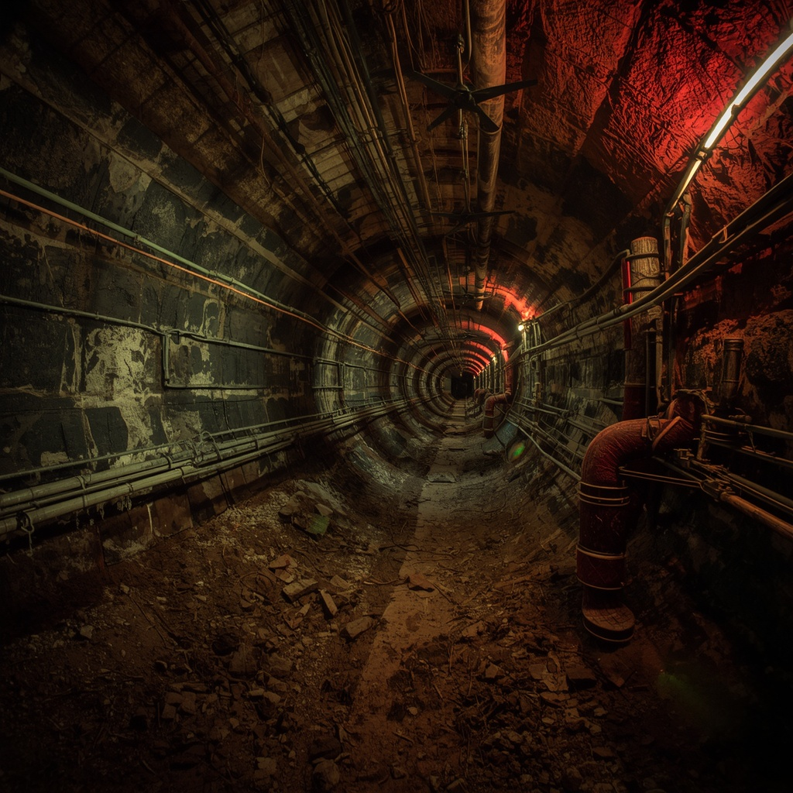
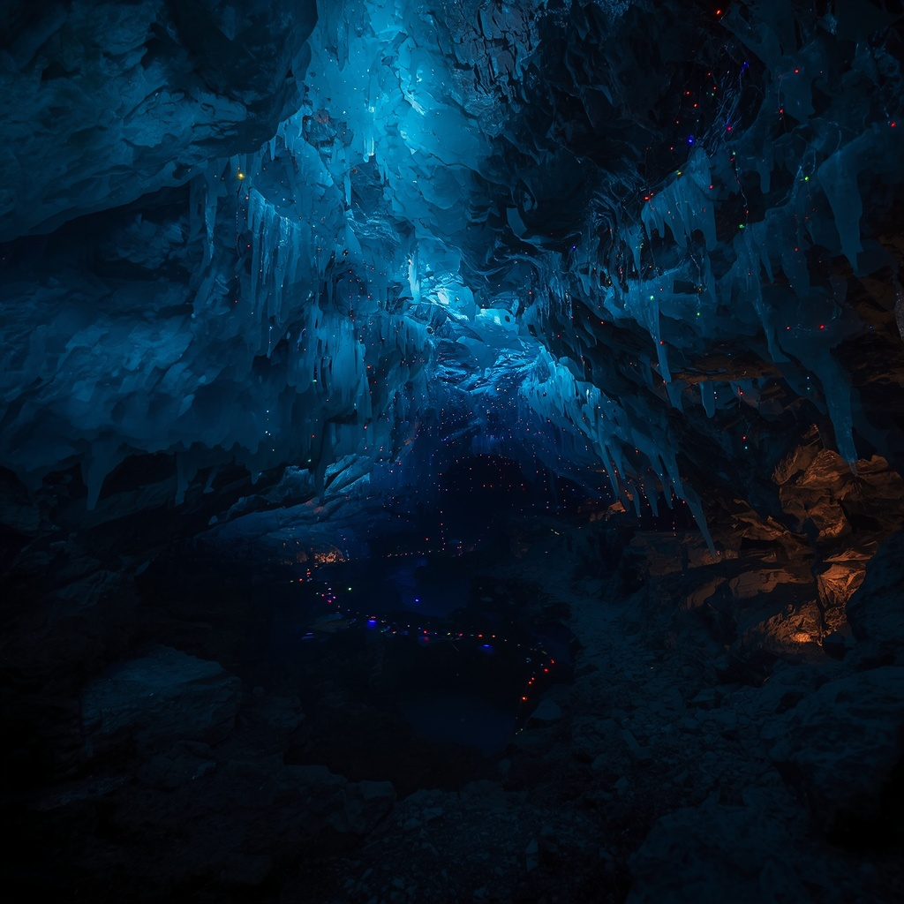
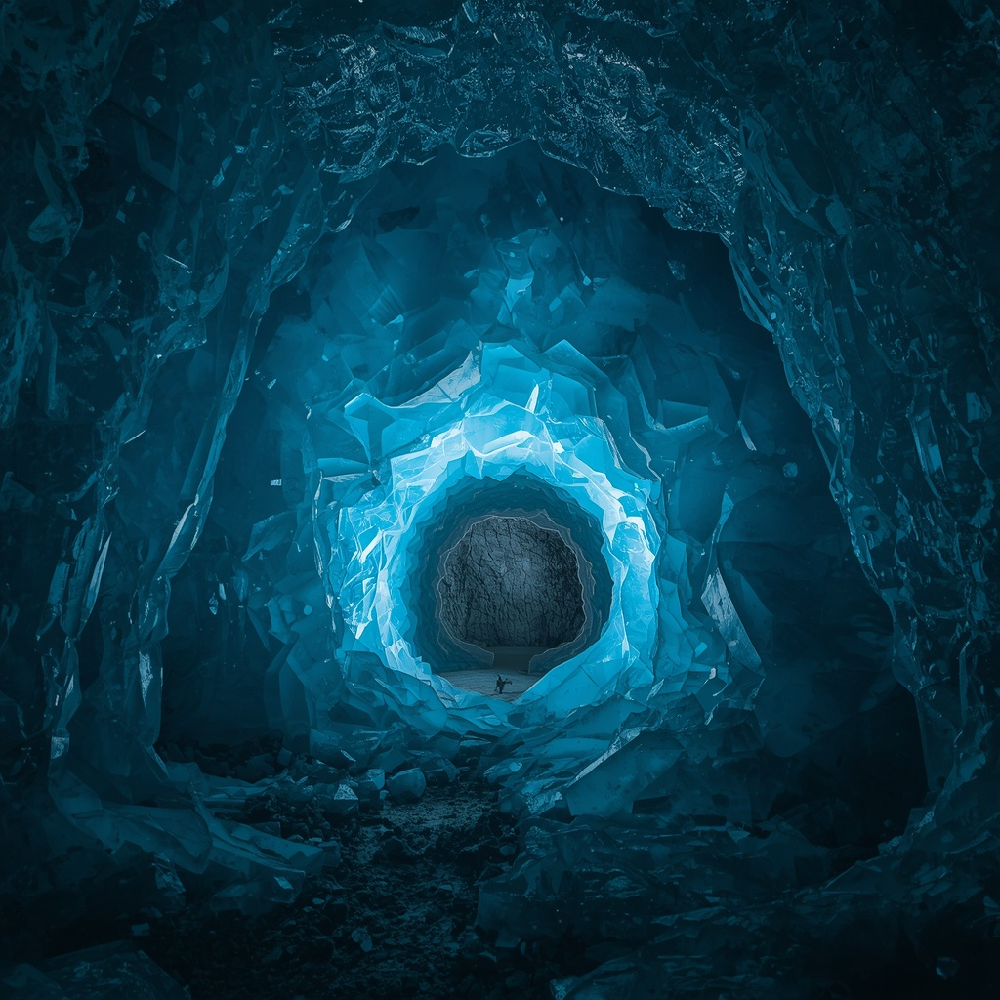
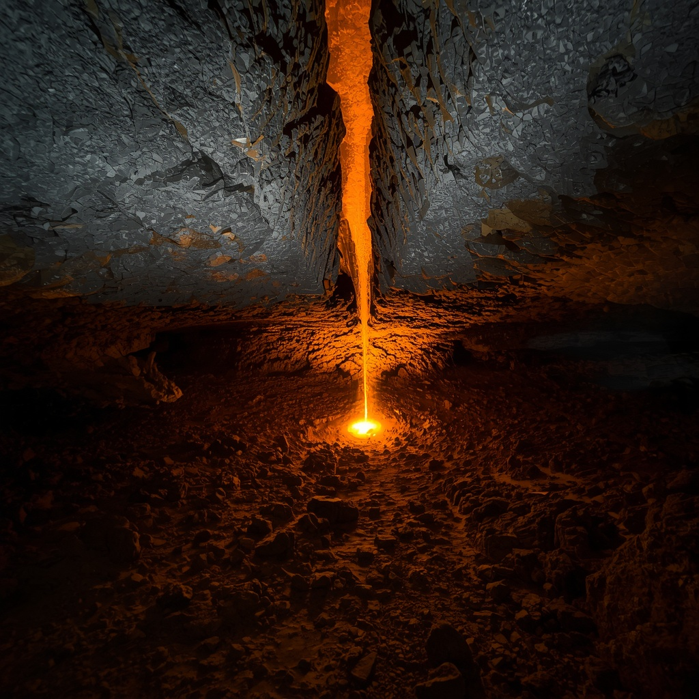

# Subsuelo y Niveles de Excavación (Estratos 1 a 3)

> **Mapeo Oficial de Arte Conceptual Subterráneo a Reglas de Minería y Progresión**

---

## 1. Túneles de Ventilación / Transición (`tunel_minero.jpg`)

* **Archivo Conceptual:** [`../02-art-bible/concept-art/paisajes/tunel_minero.jpg`](../02-art-bible/concept-art/paisajes/tunel_minero.jpg)
* **Composición y Atmósfera:** Pasillos subterráneos cilíndricos reforzados con anillos de metal oxidado, tuberías de cobre en las paredes, ventiladores en el techo cubiertos de escarcha y líneas de luces cálidas/rojas que perforan la penumbra.
* **Reglas Jugables y Mecánicas:**
  * **Zona de Transición y Logística (Drenaje Térmico: `1.0 °T/s`):** Conecta las compuertas subterráneas de la Aldea Industrial con los tres niveles de cavernas naturales.
  * **Puntos de Calor e Iluminación:** Las paredes cuentan con soportes donde el jugador despliega **guirnaldas de luces navideñas** para mantener burbujas de calor continuas y no perderse en el laberinto subterráneo.
  * **Corredor de Automatización:** Es la arteria principal por donde se tienden las **Cintas Transportadoras** desde las vetas interiores hacia los hornos de la aldea.

---

## 2. Cuevas de Nivel 1 (`cueva_de_hielo.jpg`)

* **Archivo Conceptual:** [`../02-art-bible/concept-art/paisajes/cueva_de_hielo.jpg`](../02-art-bible/concept-art/paisajes/cueva_de_hielo.jpg)
* **Composición y Atmósfera:** Cavernas glaciares iniciales con paredes y estalactitas de hielo azul cobalto que contrastan con el suelo rocoso oscuro y el destello multicolor de pequeñas guirnaldas y cristales incrustados.
* **Reglas Jugables y Mecánicas:**
  * **Primer Estrato de Excavación (Drenaje Térmico: `1.5 °T/s`):** Accesible con el **Pico Industrial Nivel 1 (Base)** y el **Faro Frontal del Casco**.
  * **Recursos Extraíbles:**
    * **Carbón Negro:** Combustible básico.
    * **Vetas de Cristal de Caramelo (Rojo):** Mineral energético incrustado en la roca helada.
    * **Hierro Polar (Gris Oscuro):** Primeras vetas metálicas para fabricar mejoras de Nivel 2.

---

## 3. La Geoda de Hielo Azul — Nivel 2 (`caverna_subterranea_profunda.jpg`)

* **Archivo Conceptual:** [`../02-art-bible/concept-art/paisajes/caverna_subterranea_profunda.jpg`](../02-art-bible/concept-art/paisajes/caverna_subterranea_profunda.jpg)
* **Composición y Atmósfera:** Cavernas profundas monocromáticas formadas por enormes bloques facetados de cristal azul transparente que refractan una intensa luz cian hacia el interior del túnel.
* **Reglas Jugables y Mecánicas:**
  * **Segundo Estrato de Excavación (Drenaje Térmico: `2.5 °T/s`):** El frío glacial es intenso; se recomienda **Abrigo Térmico Nivel 2**.
  * **Requisitos de Herramienta:** Exige el **Pico Industrial Mejorado (Nivel 2)** para fracturar los cristales y **Petardos Festivos** para despejar derrumbes de hielo macizo.
  * **Recursos Extraíbles:** Grandes concentraciones de **Hierro Polar** de alta pureza y **Hielo Azul Profundo** (refrigerante de reactores).
  * **Peligros:** Patrullada por **Soldados de Juguete Defectuosos** y custodiada por **Gólems de Escarcha**.

---

## 4. El Abismo del Núcleo Luminoso — Nivel 3 (`caverna_abismal.jpg`)

* **Archivo Conceptual:** [`../02-art-bible/concept-art/paisajes/caverna_abismal.jpg`](../02-art-bible/concept-art/paisajes/caverna_abismal.jpg)
* **Composición y Atmósfera:** La zona más profunda y peligrosa de Boreatek, donde las paredes de hielo negro y roca volcánica fracturada se dividen ante una imponente fisura vertical por la que desciende magma festivo incandescente hasta un pozo luminoso.
* **Reglas Jugables y Mecánicas:**
  * **Tercer Estrato de Excavación (Endgame — Drenaje Térmico en Accesos: `3.0 °T/s`):** Ubicado directamente sobre la falla geotérmica polar.
  * **Requisitos de Herramienta:** Exige el **Pico Industrial con Cristal Energético Nivel 3 (Máximo)**.
  * **Recurso Crítico Final:** Fuente exclusiva de los **Núcleos Luminosos**, indispensables para completar los pedidos finales de la campaña de 20 horas y activar **La Gran Nochebuena**.
