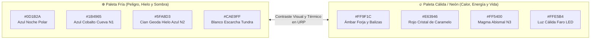

# Paleta Cromática e Iluminación en URP

---

## 1. Narrativa del Color: Frío Ártico vs. Calor Industrial

En **BOREATEK**, el color cumple una función mecánica directa: el jugador debe identificar instantáneamente de un vistazo qué zonas son letales por congelamiento y qué objetos emiten calor o energía.

### 1.1. Códigos Hexadecimales Oficiales

| Categoría | Nombre del Color | Hex | Aplicación en Materiales y Luces |
| :--- | :--- | :---: | :--- |
| **Ambiente Frío** | Azul Noche Polar | `#0D1B2A` | Color de niebla nocturna y sombras ambientales en tundra. |
| **Ambiente Frío** | Azul Cobalto Glacial | `#1B4965` | Hielo estructural de las *Cuevas de Nivel 1*. |
| **Ambiente Frío** | Cian Geoda Translúcido | `#5FA8D3` | Cristales de *La Geoda de Hielo Azul (Nivel 2)*. |
| **Ambiente Frío** | Verde Aurora Boreal | `#38B000` / `#48CAE4` | Emisión del skybox nocturno en superficie. |
| **Calor y Energía** | Ámbar Forja Industrial | `#FF9F1C` | Forja Central, Balizas Térmicas y ojos del Soldado Defectuoso. |
| **Calor y Energía** | Rojo Cristal de Caramelo | `#E63946` | Punta del pico energético, *Bosque de Caramelos* y vetas. |
| **Calor y Energía** | Naranja Magma Festivo | `#FF5400` | Fisura volcánica y *Núcleos Luminosos* en el *Abismo (Nivel 3)*. |
| **Personaje** | Verde Oliva Acolchado | `#4A5D4E` | Casco metálico y abrigo térmico del Duende Ingeniero. |
| **Personaje** | Cuero y Latón Presurizado | `#7F4F24` / `#C99E5A` | Correas del abrigo y tanque-mochila con manómetros. |

---

## 2. Configuración Técnica de Iluminación y Post-Procesado (URP `17.6.0`)

Los archivos `Assets/Settings/PC_RPAsset.asset` y `Assets/Settings/SampleSceneProfile.asset` deben configurarse bajo los siguientes parámetros:

### 2.1. Luces en Escena
1. **`Directional Light` (Sol / Luna Polar):**
   * Controlada por `DayNightCycleManager.cs`.
   * **Día (10 min):** Intensidad `1.3`, color `#D8E2DC`, sombras suaves activadas (`Soft Shadows`).
   * **Noche (10 min):** Intensidad `0.15`, color `#1B4965`.
2. **Faro Frontal del Casco (`Spot Light`):**
   * Hijo del hueso de la cabeza/casco del jugador o cámara.
   * `Range: 20m` | `Outer Spot Angle: 55°` | `Inner Spot Angle: 35°` | `Color: #FFE5B4` | `Intensity: 4.5` | `Shadows: Hard o Soft`.
3. **Guirnaldas Luminosas y Balizas Térmicas (`Point Light`):**
   * **Guirnaldas:** `Range: 6m` (coincide con el radio de su burbuja térmica), `Shadows: No Shadows` (para rendimiento óptimo al colocar decenas de guirnaldas).
   * **Baliza Térmica:** `Range: 10m`, `Color: #FF9F1C`, pulso suave de intensidad (`3.0` a `4.0`).

### 2.2. Niebla (`RenderSettings.fog`) y Volumen Global (`Volume Profile`)
* **Fog Mode:** `Exponential Squared`.
  * Día despejado: `Density = 0.008` | Noche normal: `Density = 0.015` | **Ventisca Ciega:** `Density = 0.065`.
* **Overrides en `Global Volume`:**
  * **Bloom:** `Threshold = 0.9`, `Intensity = 0.65`, `Scatter = 0.7` (hace brillar la punta roja del pico, las guirnaldas, el Bosque de Caramelos y el Abismo).
  * **Color Adjustments:** `Contrast = +12`, `Saturation = +10` (resalta la estética animada/caricaturesca).
  * **Vignette:** Controlado por código desde `TemperatureSystem.cs` (color `#5FA8D3`, `Intensity` de `0.0` a `0.45` conforme el jugador se congela).
