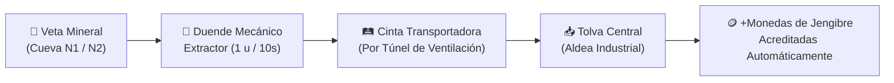

# Sistema de Automatización y Cintas Transportadoras

---

## 1. Filosofía de Automatización en Boreatek

A medida que el jugador desciende hacia *La Geoda de Hielo Azul (Nivel 2)* y *El Abismo del Núcleo Luminoso (Nivel 3)*, volver a pie hasta las *Cuevas de Nivel 1* o el *Bosque de Caramelos* para recolectar recursos básicos se vuelve ineficiente. La cuarta categoría de la tienda permite construir la **Red Automatizada Boreatek**.

---

## 2. Unidades de Automatización

### 2.1. Duende Mecánico Extractor (`Costo: 400 Monedas de Jengibre`)
* **Función:** Autómata industrial compacto y seguro (diseñado con tecnología moderna de cristal energético, libre del defecto de los antiguos Soldados de Plomo).
* **Colocación:** Se instala directamente sobre cualquier veta mineral permanente de Carbón Negro, Cristal de Caramelo, Hierro Polar o Hielo Azul.
* **Tasa de Extracción:** Extrae `1 unidad de mineral cada 10 segundos` de forma ininterrumpida.
* **Almacenamiento Local:** Cuenta con una bandeja interna de `15 unidades`. Si está conectado a una **Cinta Transportadora**, expulsa el mineral directamente sobre la cinta.

### 2.2. Cintas Transportadoras (`Costo: 60 Monedas por tramo de 10m`)
* **Función:** Conectan la salida de un **Duende Mecánico Extractor** con la **Tolva Central** de la Aldea Industrial pasando a través de los **Túneles de Ventilación**.
* **Beneficio Adicional:** Los tramos de cinta transportadora cuentan con pequeños pilotos LED laterales que ayudan a guiar al jugador en la oscuridad subterránea.

---

## 3. Flujo de la Red Logística

