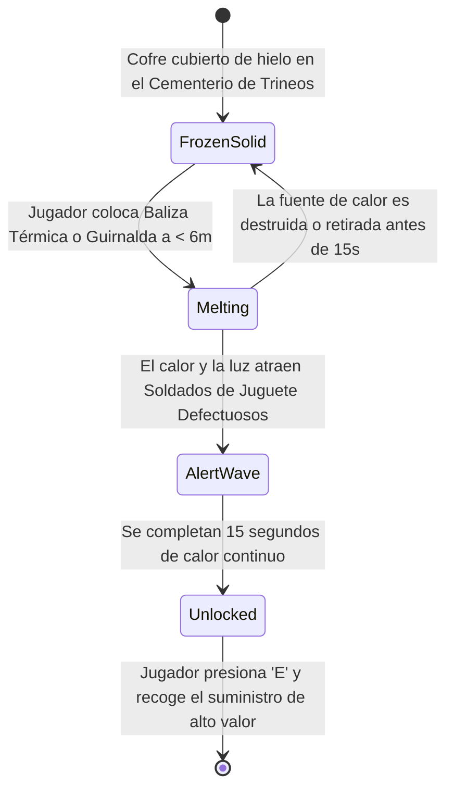

# Minería, Recursos y Nodos Recolectables

---

## 1. Reglas de Extracción (`HarvestableNode`)

Todo nodo recolectable del mundo 3D valida tres condiciones antes de entregar recursos:
1. **Nivel de Herramienta (`RequiredToolTier`):** Compara el nivel actual del **Pico Industrial con Cristal Energético Rojo** del jugador (`1`, `2` o `3`) contra la dureza del nodo.
2. **Estado de Congelamiento (`RequiresHeatToUnlock`):** Exclusivo de los **Cofres Congelados** y ciertas vetas selladas. Mientras estén cubiertos de hielo sólido, el pico rebota sin hacer daño hasta que una fuente de calor cercana complete su deshielo.
3. **Multiplicador de Sobrecarga (`OverchargeMultiplier`):**vale `1x` durante la campaña estándar y sube a `2x` durante el evento final **La Gran Nochebuena**.

---

## 2. Tabla Maestra de Recursos de Boreatek

| ID | Recurso | Nodo de Origen | Bioma / Estrato | Nivel de Pico | Golpes / Tiempo | Cantidad por Nodo | Valor Unitario en Tolva |
| :--- | :--- | :--- | :--- | :---: | :---: | :---: | :---: |
| `RES-01` | **Madera Cristalizada** | Pino Cristalizado | Tundra Exterior Inicial | Nivel 1 | `3 golpes` | `2 - 3` | `5` Monedas |
| `RES-02` | **Chatarra Polar** | Trineo Estrellado / Ruina | Tundra / Cementerio | Nivel 1 | `2.0s` (Hold `E`) | `1 - 3` | `10` Monedas |
| `RES-03` | **Carbón Negro** | Veta de Carbón | Cuevas de Nivel 1 | Nivel 1 | `4 golpes` | `2 - 4` | `12` Monedas |
| `RES-04` | **Cristal de Caramelo** | Árbol de Caramelo / Veta Roja | Bosque de Caramelos / Cuevas N1 | Nivel 1 - 2 | `5 golpes` | `2 - 3` | `25` Monedas |
| `RES-05` | **Hierro Polar** | Veta de Hierro Azulado | Cuevas N1 / Geoda Hielo Azul N2 | Nivel 2 | `6 golpes` | `2 - 3` | `40` Monedas |
| `RES-06` | **Hielo Azul Profundo** | Bloque Geométrico de Geoda | La Geoda de Hielo Azul (Nivel 2) | Nivel 2 | `8 golpes` | `1 - 2` | `75` Monedas |
| `RES-07` | **Botín de Cofre Congelado** | Cofre Siniestrado en Hielo | El Cementerio de Trineos | Baliza Térmica | `15s` de deshielo | `1 Lote` | `120` Monedas |
| `RES-08` | **Núcleo Luminoso** | Fisura de Magma Festivo | El Abismo del Núcleo Luminoso (N3) | Nivel 3 | `12 golpes` | `1` | `200` Monedas |

---

## 3. Mecánica Especial: Deshielo de Cofres Congelados

