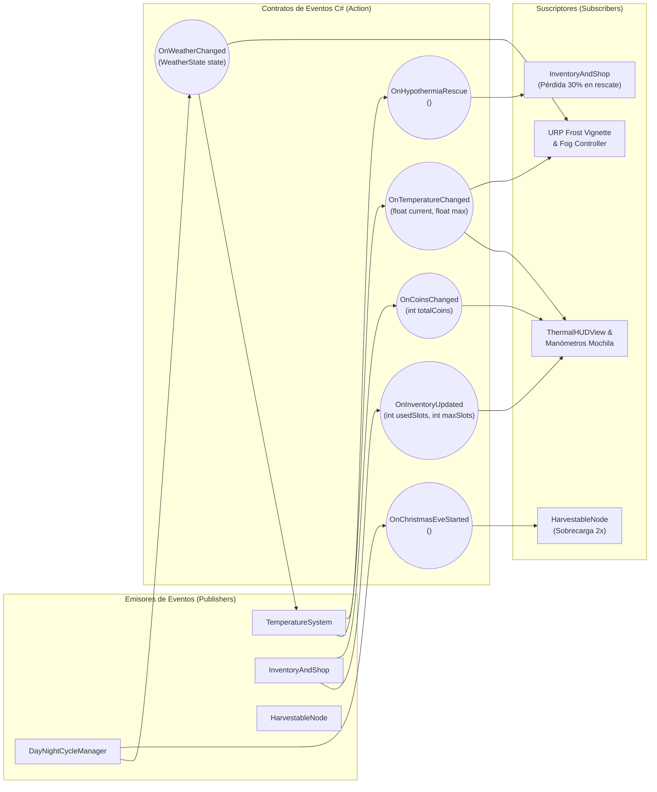

# Arquitectura de Eventos y Comunicación Desacoplada (Nivel C3)

---

## 1. Regla de Desacoplamiento entre Módulos

En **BOREATEK**, la interfaz gráfica (`UI`), el sistema de iluminación (`URP`) y el inventario **nunca son llamados directamente** por la lógica de física o de tiempo en cada frame. En su lugar, la comunicación sigue el patrón **Observer** mediante eventos nativos de C# (`event Action<T>`) e interfaces de contrato (`IInteractable`).

---

## 2. Mapa del Bus de Eventos del Juego



---

## 3. Contrato de Interacción Polimórfica (`IInteractable`)

Para evitar que `PlayerController.cs` tenga que conocer clases concretas como `CentralHopper`, `FrozenChest`, `ShopTerminal` o `HeatSourceNode`, todos implementan:

```csharp
namespace Boreatek.Core
{
    public interface IInteractable
    {
        string GetInteractionPrompt();
        bool CanInteract(int playerToolTier);
        void Interact(GameObject interactor);
    }
}
```
