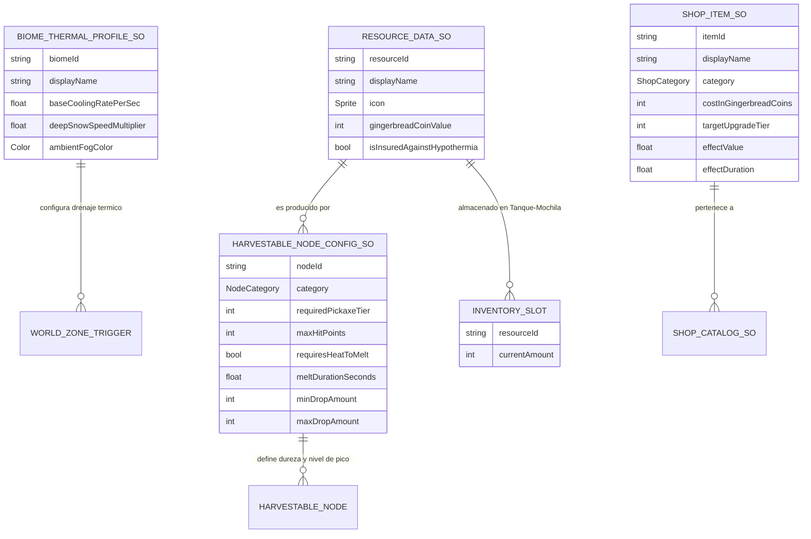

# Modelo de Datos y Relaciones (`ScriptableObjects` & Runtime State)

> **Equivalente al Diagrama Entidad-Relación (ER) para la Arquitectura Orientada a Datos en Unity 6**

---

## 1. Diagrama de Entidades de Datos y Estado en Runtime

---

## 2. Ventajas del Modelo Basado en `ScriptableObjects`

1. **Cero Duplicación en Memoria:** Si existen 200 *Pinos Cristalizados* y 150 vetas de *Cristal de Caramelo* en la escena, todos apuntan a la misma instancia en memoria de `HARVESTABLE_NODE_CONFIG_SO`.
2. **Balanceo sin Recompilar Código:** Los diseñadores pueden ajustar en el Inspector el valor en **Monedas de Jengibre** de cada mineral, la tasa de enfriamiento del *Cementerio de Trineos* o el costo del *Pico Nivel 2* incluso mientras prueban el juego en el Editor.
