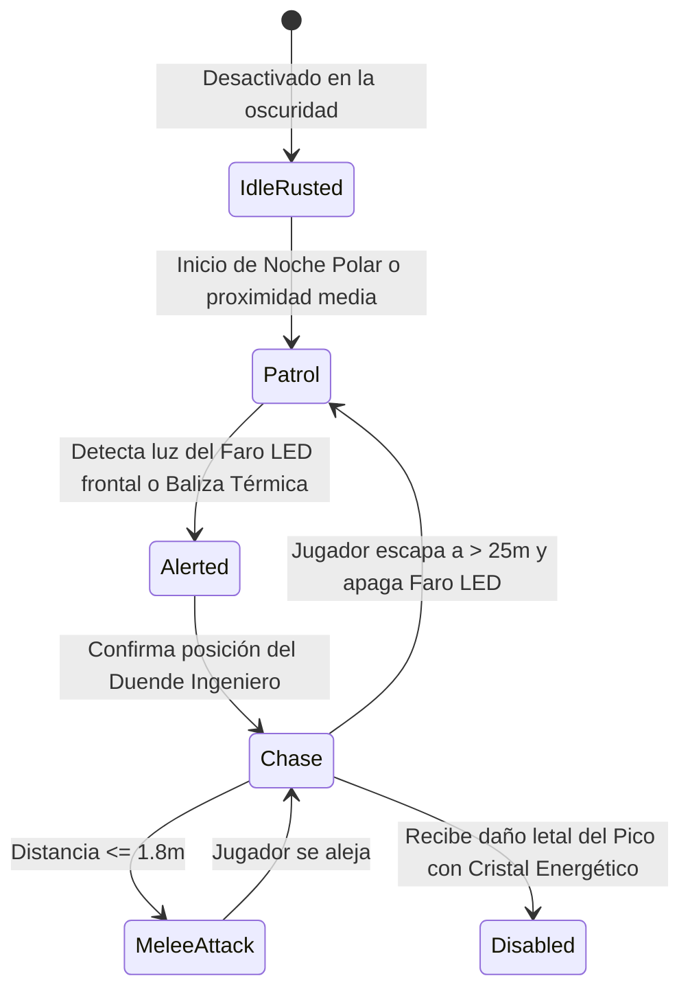

# Módulo M-06 y M-07: IA de Juguetes Defectuosos y Red de Automatización

* **Namespaces:** `Boreatek.AI` y `Boreatek.Automation`
* **Rutas destino en Unity:**
  * `Assets/_Project/Scripts/AI/DefectiveToyAI.cs`
  * `Assets/_Project/Scripts/Automation/MechanicalElfExtractor.cs`
  * `Assets/_Project/Scripts/Automation/ConveyorBelt.cs`

---

## 1. Módulo M-06: `DefectiveToyAI.cs` (Soldado de Juguete Defectuoso)

Utiliza `NavMeshAgent` del paquete `com.unity.ai.navigation` (`2.0.14`) para patrullar los túneles de ventilación, *El Cementerio de Trineos* y las cavernas profundas.

### 1.1. Máquina de Estados Finitos (FSM)

---

## 2. Módulo M-07: `MechanicalElfExtractor.cs` y `ConveyorBelt.cs`

Permiten automatizar la recolección desde un `HarvestableNode` hasta la `CentralHopper` de la aldea:

* **`MechanicalElfExtractor`:**
  * Se acopla a una veta mineral.
  * Cada `_extractionIntervalSeconds` (`10s`), genera `1` unidad del recurso de la veta (o `2` unidades durante **La Gran Nochebuena**).
  * Si tiene un `ConveyorBelt` conectado, transfiere el mineral directamente a la cinta transportadora.
* **`ConveyorBelt`:**
  * Desplaza visualmente los paquetes de mineral a lo largo de los **Túneles de Ventilación** y, al llegar al nodo final conectado a la **Tolva Central**, llama a `InventoryAndShop.AddGingerbreadCoins(resource.CoinValue)`.
