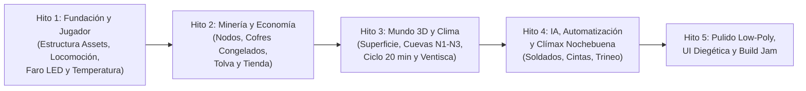

# Roadmap de Desarrollo e Hitos (Milestones)

---

## 1. Flujo de Fases de Implementación

---

## 2. Desglose de Entregables por Hito

| Hito | Nombre de la Fase | Entregables Clave | Criterio de Aceptación |
| :---: | :--- | :--- | :--- |
| **M1** | **Fundación y Supervivencia** | Jerarquía `Assets/_Project/`, `PlayerController.cs`, `TemperatureSystem.cs`, `HeatSourceNode.cs`. | El jugador camina sobre nieve, enciende su faro frontal, pierde calor fuera de la aldea y se calienta junto a una guirnalda. |
| **M2** | **Minería y Economía** | `HarvestableNode.cs`, `InventoryAndShop.cs`, `ResourceDataSO`, `ShopItemSO`. | El jugador pica madera/minerales, derrite un cofre congelado con una baliza, vende todo en la Tolva Central y mejora su pico. |
| **M3** | **Mundo, Estratos y Clima** | `DayNightCycleManager.cs`, escenarios 3D *low-poly* de superficie y cavernas N1-N3, niebla de **Ventisca Ciega**. | El ciclo día/noche de 20 minutos transiciona la luz y activa ventiscas que reducen la visibilidad y aceleran el frío. |
| **M4** | **IA, Automatización y Clímax** | `DefectiveToyAI.cs`, `MechanicalElfExtractor.cs`, `ConveyorBelt.cs` y evento **La Gran Nochebuena**. | El Soldado de Plomo patrulla y reacciona a la luz; los autómatas envían minerales por cintas y la Nochebuena duplica drops (`2x`). |
| **M5** | **Pulido Visual y Entrega** | Shaders (`SG_StylizedCrystal`, `SG_TranslucentBlueIce`), HUD, SFX y build Windows 64-bit. | Juego estable a `60+ FPS` con estética 3D estilizada uniforme y bucle completo jugable. |
