# 🎄⚙️ BOREATEK

> **Mini Game Jam — Una navidad distinta a la ordinaria (3D)**
>
> **Motor:** Unity 3D (`6000.6.0f1` URP) | **Género:** Exploración, Supervivencia, Minería y Automatización en Primera/Tercera Persona

---

## 📖 Sinopsis

Olvida los talleres de madera iluminados por velas y los villancicos alegres. En **BOREATEK**, la Navidad es una operación de exploración e ingeniería pesada en la frontera más hostil del planeta. Eres un **Duende Ingeniero** que debe abandonar el resguardo térmico de la Aldea de Santa para recorrer la vasta superficie ártica y excavar profundas cavernas heladas, sobreviviendo a las ventiscas mientras construyes una red automatizada capaz de abastecer el **Gran Despegue de Nochebuena**.

---

## 🎨 Dirección de Arte y Gráficos (Aclaración Crítica)

> [!IMPORTANT]
> **Estilo Visual Final vs. Concept Art:**
> Aunque las **11 ilustraciones conceptuales** adjuntas en este documento presentan un acabado realista y cinematográfico, **el videojuego en Unity 3D tendrá un estilo animado, estilizado / *low-poly* texturizado** (con proporciones caricaturescas, geometría limpia, colores vibrantes y materiales estilizados en URP).
>
> **Las imágenes de Concept Art deben utilizarse exclusivamente como referencias de:**
> * **Composición y Escala:** Distribución de elementos arquitectónicos, profundidad de cavernas y lectura espacial de biomas.
> * **Atmósfera y Narrativa Ambiental:** Sensación de aislamiento polar, contraste industrial pesado y misterio subterráneo.
> * **Siluetas y Diseño de Entidades:** Formas clave reconocibles en estructuras, herramientas, protagonista y autómatas enemigos.
> * **Iluminación y Paleta Cromática:** Contraste dramático entre las **luces frías árticas** (azules cobalto, cian de auroras, blancos glaciares) y las **luces cálidas/neón industriales** (ámbar de forjas, rojo carmesí de cristales de caramelo, guirnaldas festivas y fisuras geotérmicas).
>
> *En ningún caso estas imágenes deben interpretarse como referencia de fotorrealismo para el modelado o texturizado final dentro del motor.*

---

## 🌌 Lore: La Frontera Polar y la Campaña de Invierno

### El mundo más allá de la Aldea

Durante siglos, el mundo creyó que los juguetes se tallaban en un pequeño taller acogedor. La verdad es que el Polo Norte es una inmensa región inexplorada conocida como **Boreatek**, levantada sobre una falla geotérmica única en la Tierra. Para mantener viva la producción navideña, los duendes ingenieros deben aventurarse tanto por la tundra exterior —plagada de bosques cristalizados, antiguas ruinas árticas y trineos de carga estrellados— como en las profundidades subterráneas donde yacen minerales imposibles como el **Cristal de Caramelo**, el **Hierro Polar**, el **Hielo Azul Profundo** y los **Núcleos Luminosos**.

Sin embargo, el clima exterior es letal y tanto los páramos nevados como los túneles profundos están habitados por antiguos prototipos de juguetes defectuosos que cobraron vida de forma hostil y fueron abandonados décadas atrás.

### Una sola temporada: Progresión de 20 Horas

Toda la aventura transcurre de forma coherente durante **una misma campaña invernal** previa a la Navidad, sin saltos de años ni alteraciones temporales:

* **Ciclo Día y Noche Realista:** Al igual que en juegos como *Minecraft*, cada día completo dura **20 minutos en tiempo real** (10 minutos de luz ártica tenue para explorar la superficie con mayor visibilidad y 10 minutos de noche polar con ventiscas más agresivas).
* **Desarrollo Progresivo:** A lo largo de **20 horas de partida**, el jugador traza rutas por la superficie, descubre nuevos biomas helados, excava estratos cada vez más profundos y expande la infraestructura industrial de la aldea hasta alcanzar el único gran evento del año: **La Gran Nochebuena**.

---

## 🗺️ Biomas, Clima y Entidades (Referencia Conceptual y Reglas Jugables)

A continuación se detalla el mapeo completo de las **11 piezas de arte conceptual**, vinculando su dirección visual con las mecánicas, recursos y reglas del diseño de niveles.

### 1. Superficie y Clima

#### 🏭 Aldea Industrial de Santa (`paisaje_nevado_futurista_industrial..jpg`)
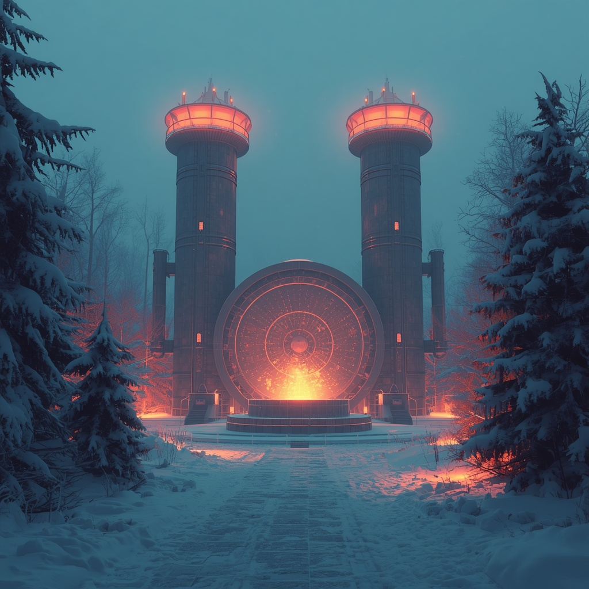
* **Archivo de referencia:** [`Art/ConceptArt/Paisajes/paisaje_nevado_futurista_industrial..jpg`](Art/ConceptArt/Paisajes/paisaje_nevado_futurista_industrial..jpg)
* **Descripción Visual y Atmosférica:** Imponente complejo industrial flanqueado por pinos nevados, dominado por dos torres gemelas de acero y cobre coronadas con anillos de observación luminosos y una colosal **Forja Central** circular que irradia luz cálida ámbar/neón sobre el sendero helado.
* **Reglas Jugables y Mecánicas:**
  * **Zona Segura Base (Hub Central):** Al ingresar al perímetro térmico de la aldea, el medidor de temperatura corporal del jugador se regenera automáticamente al máximo y cesa cualquier penalización por hipotermia.
  * **Economía y Tolva Central:** Aquí el jugador deposita los minerales y recursos recolectados en la tolva de la forja para convertirlos en **Monedas de Jengibre / Fichas del Taller**.
  * **Progresión e Infraestructura:** Punto de acceso a la tienda de consumibles, mejoras permanentes de equipo y terminal de despacho de autómatas y cintas transportadoras.

#### 🌌 Tundra Exterior Inicial (`tundra_helada_bajo_aurora_boreal.jpg`)
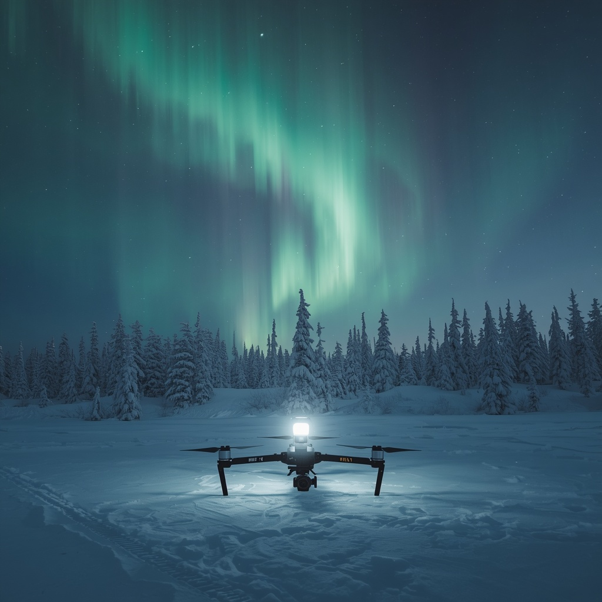
* **Archivo de referencia:** [`Art/ConceptArt/Paisajes/tundra_helada_bajo_aurora_boreal.jpg`](Art/ConceptArt/Paisajes/tundra_helada_bajo_aurora_boreal.jpg)
* **Descripción Visual y Atmosférica:** Llanura ártica abierta bajo un cielo nocturno iluminado por intensas auroras boreales verde esmeralda, delimitada por frondosos bosques de coníferas escarchadas y restos tecnológicos de reconocimiento sobre la nieve.
* **Reglas Jugables y Mecánicas:**
  * **Bioma de Exploración Básica (Nivel 0 - Superficie):** Primera zona fuera de las compuertas térmicas de la aldea, con pérdida de temperatura moderada y terreno amplio para trazar las primeras líneas de guirnaldas luminosas.
  * **Recursos Principales:**
    * **Pinos Cristalizados:** Fuente primaria de madera densa para construir soportes, postes de cableado y estructuras básicas.
    * **Trineos Estrellados y Drones de Suministro:** Puntos de interés iniciales donde se recolecta chatarra útil, piezas mecánicas básicas y suministros de emergencia.

#### 🍬 Bosque de Caramelos Gigantes (`bosque_surrealista_y_brillante.jpg`)
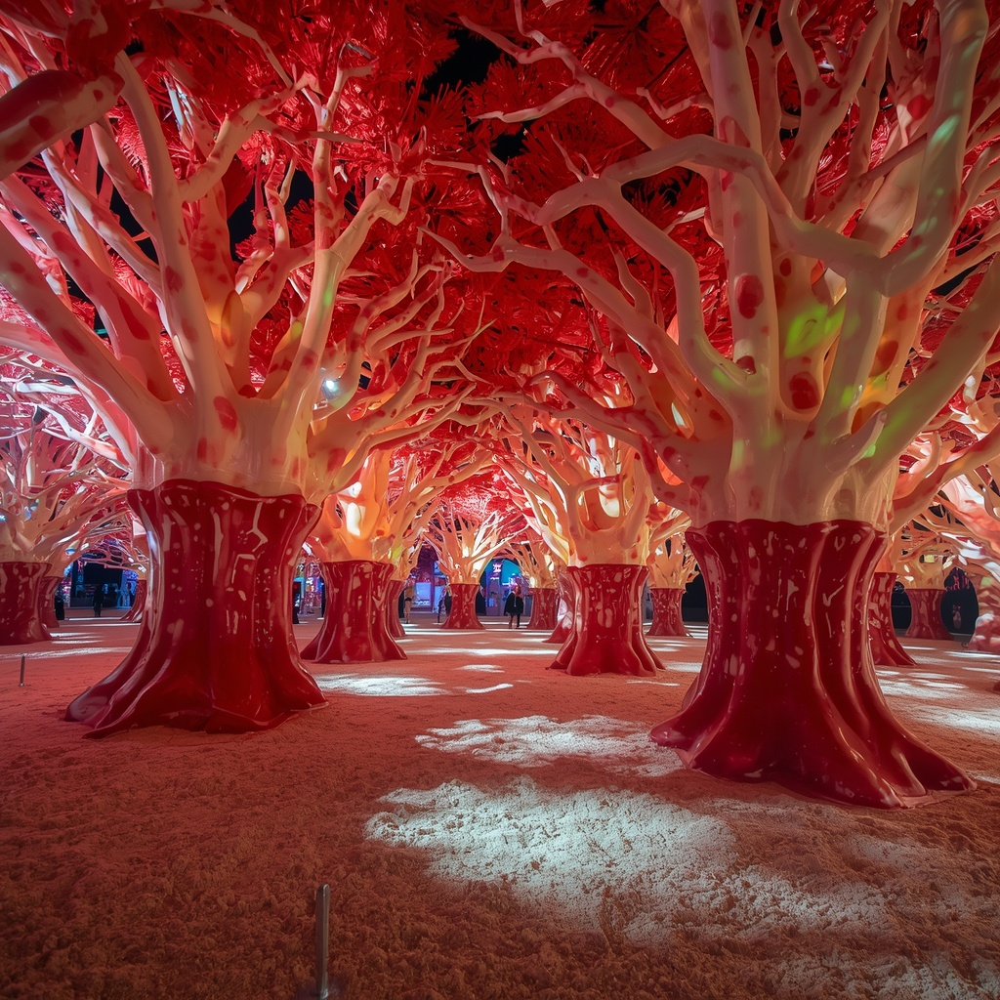
* **Archivo de referencia:** [`Art/ConceptArt/Paisajes/bosque_surrealista_y_brillante.jpg`](Art/ConceptArt/Paisajes/bosque_surrealista_y_brillante.jpg)
* **Descripción Visual y Atmosférica:** Bioma surrealista y vibrante compuesto por formaciones arbóreas colosales de cristal de caramelo rojo carmesí y blanco marfil que se ramifican formando un dosel luminoso sobre un suelo escarchado teñido de reflejos rojizos.
* **Reglas Jugables y Mecánicas:**
  * **Bioma de Superficie de Nivel Medio:** Ubicado a media distancia de la aldea; exige haber establecido rutas térmicas previas o contar con herramientas mejoradas (**Hacha/Pico Polar**).
  * **Recurso Principal:** Fuente principal en superficie de **Cristal de Caramelo**, el mineral energético de alta cotización indispensable para alimentar la maquinaria festiva, baterías de herramientas y autómatas.

#### 🛷 El Cementerio de Trineos (`paramo_desolado_de_nieve_profunda.jpg`)
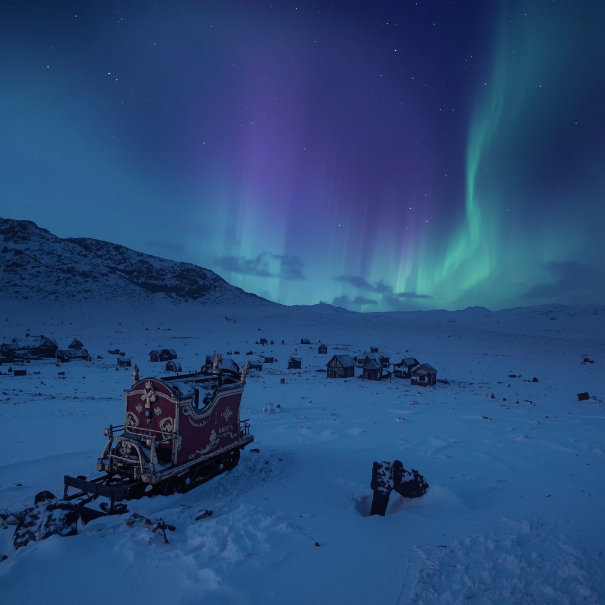
* **Archivo de referencia:** [`Art/ConceptArt/Paisajes/paramo_desolado_de_nieve_profunda.jpg`](Art/ConceptArt/Paisajes/paramo_desolado_de_nieve_profunda.jpg)
* **Descripción Visual y Atmosférica:** Páramo desolado de nieve profunda bajo auroras violetas y cian, salpicado de antiguos trineos de carga rojos y dorados semienterrados, cabañas en ruinas y restos mecánicos congelados al pie de las montañas polares.
* **Reglas Jugables y Mecánicas:**
  * **Zona Exterior Lejana de Alto Riesgo:** Las bajas temperaturas extremas y la nieve profunda ralentizan el movimiento si no se cuenta con mejoras térmicas.
  * **Cofres Congelados de Alto Valor:** Los trineos abandonados resguardan cajas de suministros selladas por hielo sólido. Para abrirlas, el jugador debe **desplegar una fuente de calor (baliza térmica o guirnalda) junto al cofre y defender la posición** mientras el hielo se derrite.
  * **Amenaza Activa:** Zona patrullada constantemente por **Juguetes Defectuosos** atraídos por el calor y la luz de las balizas.

#### 🌨️ Evento Climático: Ventisca Ciega (`aldea_industrial_de_BOREATEK_bajo_ventisca.jpg`)
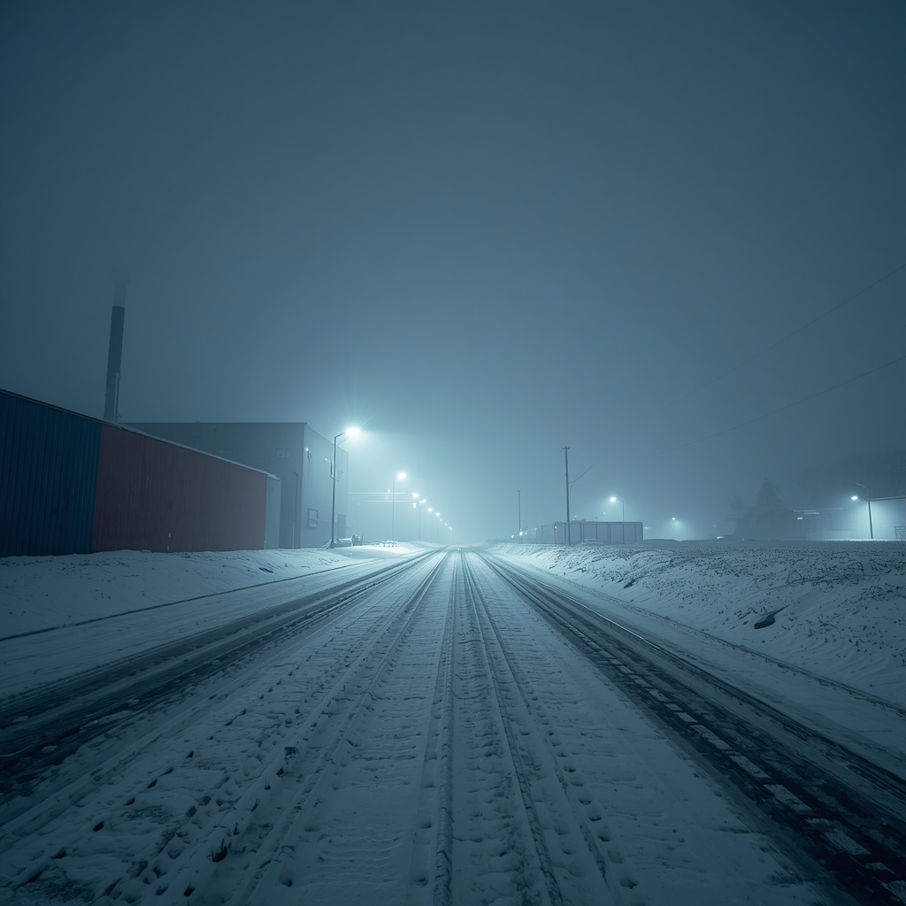
* **Archivo de referencia:** [`Art/ConceptArt/Paisajes/aldea_industrial_de_BOREATEK_bajo_ventisca.jpg`](Art/ConceptArt/Paisajes/aldea_industrial_de_BOREATEK_bajo_ventisca.jpg)
* **Descripción Visual y Atmosférica:** Densa niebla glacial azulada que envuelve las estructuras industriales y los caminos nevados, donde únicamente los faroles de neón y las balizas logran perforar la cortina de nieve a corta distancia.
* **Reglas Jugables y Mecánicas:**
  * **Estado Dinámico del Clima:** Se activa periódicamente (con mayor frecuencia e intensidad durante los 10 minutos de noche polar y durante el clímax de *La Gran Nochebuena*).
  * **Penalización Jugable:** Reduce drásticamente el rango de visibilidad (fog denso en URP) y **multiplica la tasa de pérdida de temperatura corporal**.
  * **Contramedidas:** Obliga al jugador a guiarse por las líneas de **Guirnaldas Luminosas** previamente instaladas, buscar refugio inmediato o consumir un **Termo de Chocolate Caliente** para frenar el congelamiento.

---

### 2. Subsuelo y Niveles de Excavación

#### 🚇 Túneles de Ventilación / Transición (`tunel_minero.jpg`)
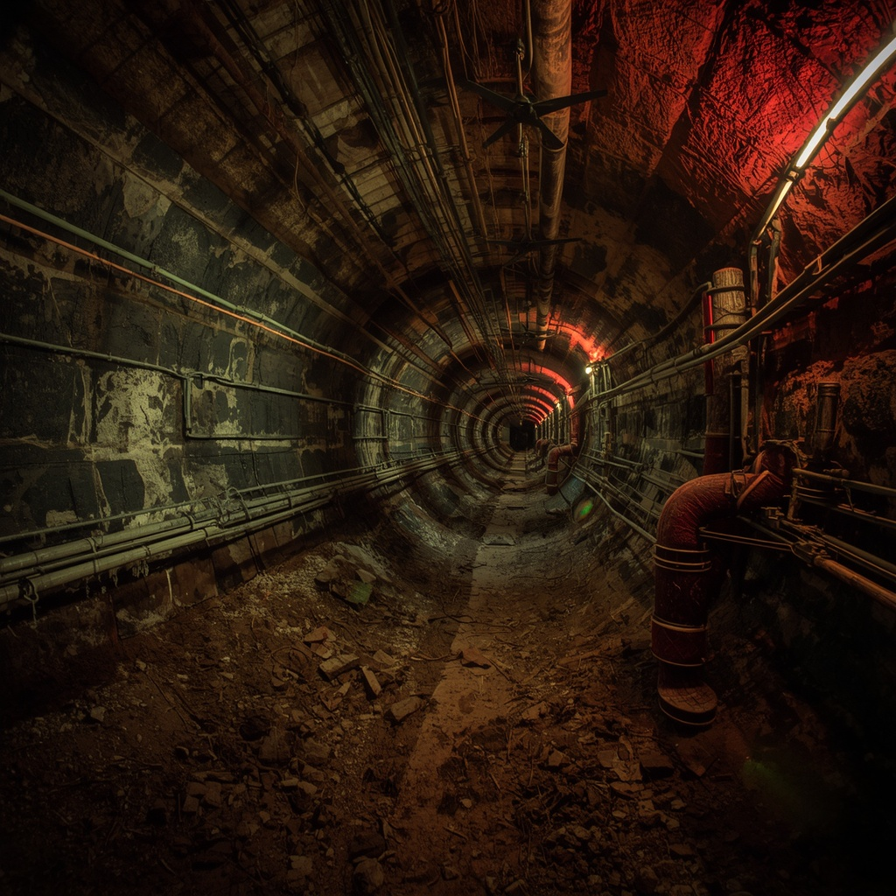
* **Archivo de referencia:** [`Art/ConceptArt/Paisajes/tunel_minero.jpg`](Art/ConceptArt/Paisajes/tunel_minero.jpg)
* **Descripción Visual y Atmosférica:** Conductos subterráneos cilíndricos reforzados con anillos metálicos, tuberías de cobre corroído, ventiladores industriales cubiertos de escarcha y líneas de iluminación rojiza/cálida que guían hacia la oscuridad.
* **Reglas Jugables y Mecánicas:**
  * **Conectores Subterráneos:** Sirven como zonas de transición entre la superficie/aldea y los distintos estratos de cavernas naturales.
  * **Red de Supervivencia y Orientación:** El jugador puede anclar **Guirnaldas de Luces Navideñas** a lo largo de las paredes y tuberías para crear **burbujas de calor**, mantener rutas iluminadas para no perderse y tender las líneas de **cintas transportadoras** hacia los hornos de la aldea.

#### 🧊 Cuevas de Nivel 1 (`cueva_de_hielo.jpg`)
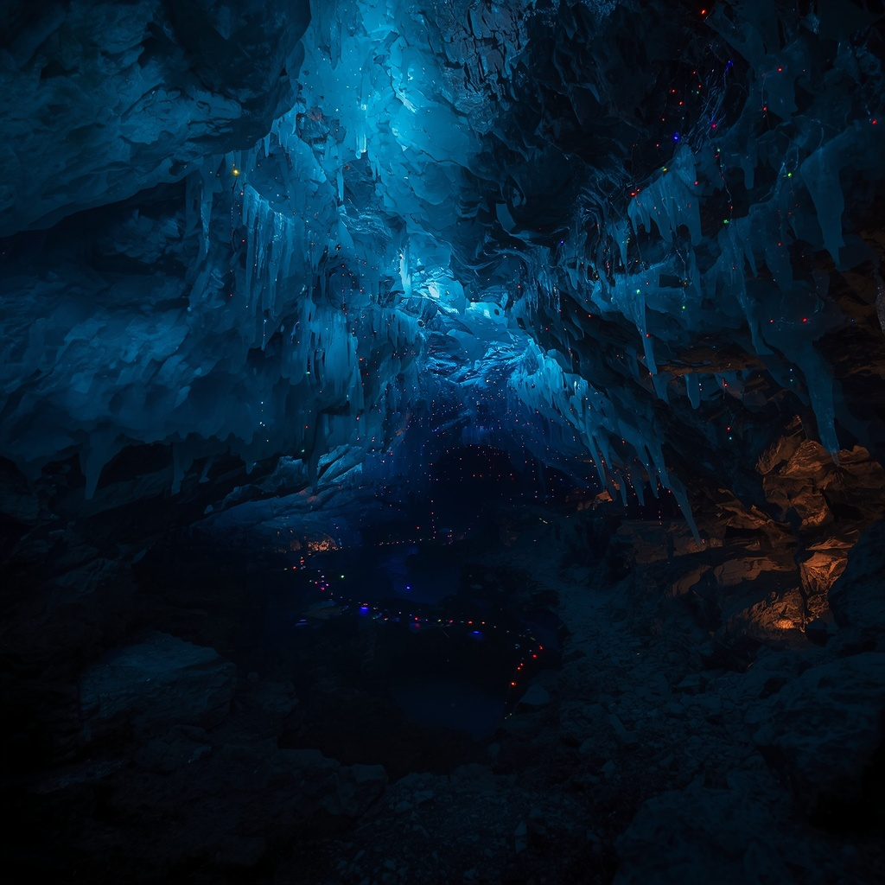
* **Archivo de referencia:** [`Art/ConceptArt/Paisajes/cueva_de_hielo.jpg`](Art/ConceptArt/Paisajes/cueva_de_hielo.jpg)
* **Descripción Visual y Atmosférica:** Cavernas glaciares iniciales con bóvedas de hielo azul cobalto y estalactitas afiladas, salpicadas por destellos multicolores de pequeñas luces festivas y reflejos minerales rojizos y ambarinos en las paredes rocosas.
* **Reglas Jugables y Mecánicas:**
  * **Primer Estrato de Minería:** Accesible con el equipamiento básico del Duende Ingeniero.
  * **Recursos Extraíbles:**
    * **Carbón Negro:** Combustible esencial para hornos y calefacción.
    * **Vetas de Cristal de Caramelo (Rojo):** Energía festiva en estado mineral.
    * **Hierro Polar (Gris Oscuro):** Metal base para forjar las primeras mejoras de herramientas, vagonetas y componentes mecánicos.

#### 💎 La Geoda de Hielo Azul - Nivel 2 (`caverna_subterranea_profunda.jpg`)
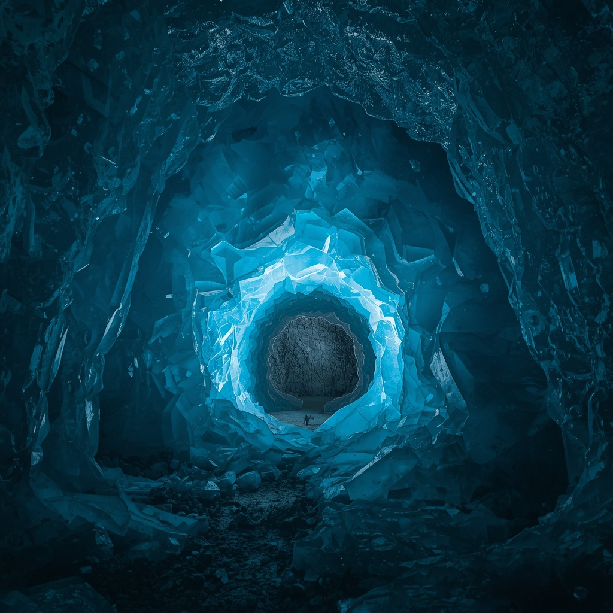
* **Archivo de referencia:** [`Art/ConceptArt/Paisajes/caverna_subterranea_profunda.jpg`](Art/ConceptArt/Paisajes/caverna_subterranea_profunda.jpg)
* **Descripción Visual y Atmosférica:** Colosal túnel cavernoso monocromático conformado por facetas geométricas de cristal de hielo azul translúcido que refractan una luz cian brillante desde el centro de la cámara.
* **Reglas Jugables y Mecánicas:**
  * **Segundo Estrato de Minería (Profundidad Media-Alta):** El frío ambiental es severo y la dureza de las paredes impide excavar con herramientas iniciales (**requiere Pico Polar mejorado** y uso de **Petardos Festivos** para despejar bloqueos).
  * **Recursos Extraíbles:** Grandes concentraciones de **Hierro Polar** de alta pureza y **Hielo Azul Profundo** (indispensable para refrigerar los reactores avanzados de la aldea y fabricar autómatas de nivel superior).
  * **Peligros:** Custodiado por patrullas de autómatas defectuosos y **Gólems de Escarcha**.

#### 🌋 El Abismo del Núcleo Luminoso - Nivel 3 (`caverna_abismal.jpg`)
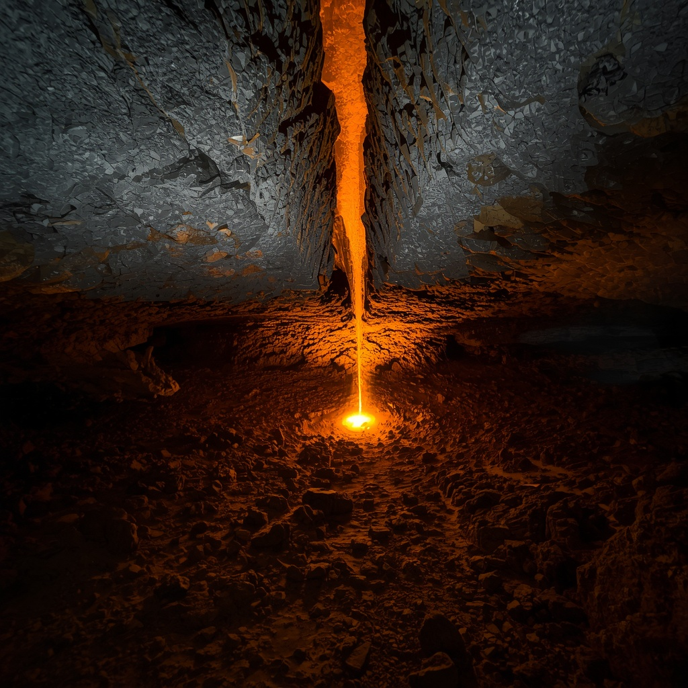
* **Archivo de referencia:** [`Art/ConceptArt/Paisajes/caverna_abismal.jpg`](Art/ConceptArt/Paisajes/caverna_abismal.jpg)
* **Descripción Visual y Atmosférica:** La grieta geotérmica más profunda de Boreatek, donde los muros de roca basáltica y hielo negro se abren en una fisura vertical incandescente por la que fluye magma festivo dorado/anaranjado hacia un pozo energético radiante.
* **Reglas Jugables y Mecánicas:**
  * **Tercer Estrato de Minería (Endgame / Pre-Nochebuena):** La zona más profunda, hostil y peligrosa del subsuelo, directamente sobre la falla geotérmica polar.
  * **Recurso Crítico Final:** Fuente exclusiva de los **Núcleos Luminosos**, minerales geotérmicos de máxima energía requeridos para completar los pedidos finales de la campaña de 20 horas y activar a plena potencia el **Gran Despegue de Nochebuena**.

---

### 3. Personajes y Enemigos

#### ⛏️ Protagonista: Duende Ingeniero / Minero (`concepto_duende_minero.png`)
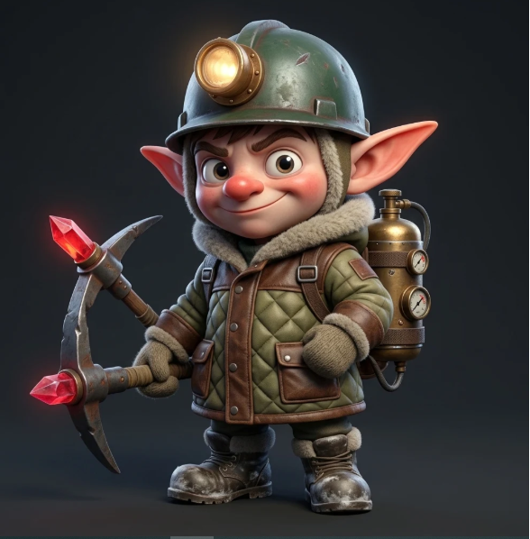
* **Archivo de referencia:** [`Art/ConceptArt/Personajes/concepto_duende_minero.png`](Art/ConceptArt/Personajes/concepto_duende_minero.png)
* **Rediseño Visual, Identidad Propia y Coherencia de Estilo:**
  * **Estilo 3D Estilizado y Caricaturesco:** El protagonista abandona cualquier estética oscura o monstruosa para adoptar un diseño **3D estilizado y caricaturesco** con proporciones *chibi*/compactas, cabeza grande expresiva, ojos amplios, nariz rojiza por el frío polar y orejas puntiagudas prominentes, alineándose directamente con la dirección de arte animada del juego en Unity 3D.
  * **Propiedad Intelectual 100 % Original:** Diseño concebido desde cero como IP propia para **BOREATEK**; sustituye el clásico gorro navideño de tela con cascabel por equipamiento industrial ártico pesado, evitando cualquier similitud con personajes externos o arquetipos genéricos.
* **Mapeo de Equipamiento Jugable y Sistemas Asociados:**
  1. **Casco Minero Metálico con Faro Frontal:** Objeto equipado desde el inicio de la partida (`PlayerController.cs`) que proyecta un cono de luz cálida direccional indispensable para orientarse en las cuevas oscuras y en los túneles de ventilación.
  2. **Abrigo Térmico Acolchado (Verde Oliva y Cuero con Forro de Borrego) + Botas de Nieve:** Representa el nivel base de aislamiento y protección contra el frío en la tundra exterior (`TemperatureSystem.cs`); sus mejoras progresivas en la tienda reducen permanentemente la velocidad de congelamiento ante ventiscas y estratos profundos.
  3. **Tanque-Mochila Presurizado de Latón con Manómetros:** Reemplaza la mochila convencional (`InventoryAndShop.cs` / `TemperatureSystem.cs`); funciona simultáneamente como indicador visual diegético del sistema térmico/energético del personaje y define la capacidad máxima de carga de minerales antes de tener que regresar a descargar en la tolva central.
  4. **Pico Industrial con Cristal Energético Rojo:** Herramienta principal de extracción (`HarvestableNode.cs`) potenciada con una punta incandescente de **Cristal de Caramelo**, cuya eficiencia de minería y daño estructural contra vetas de alta dureza (como el *Hierro Polar* o el *Hielo Azul Profundo*) aumentan mediante mejoras en el taller de la aldea.

#### 🤖 Enemigo: Soldado de Juguete Defectuoso (`concepto_juguete_de_plomo.jpg`)
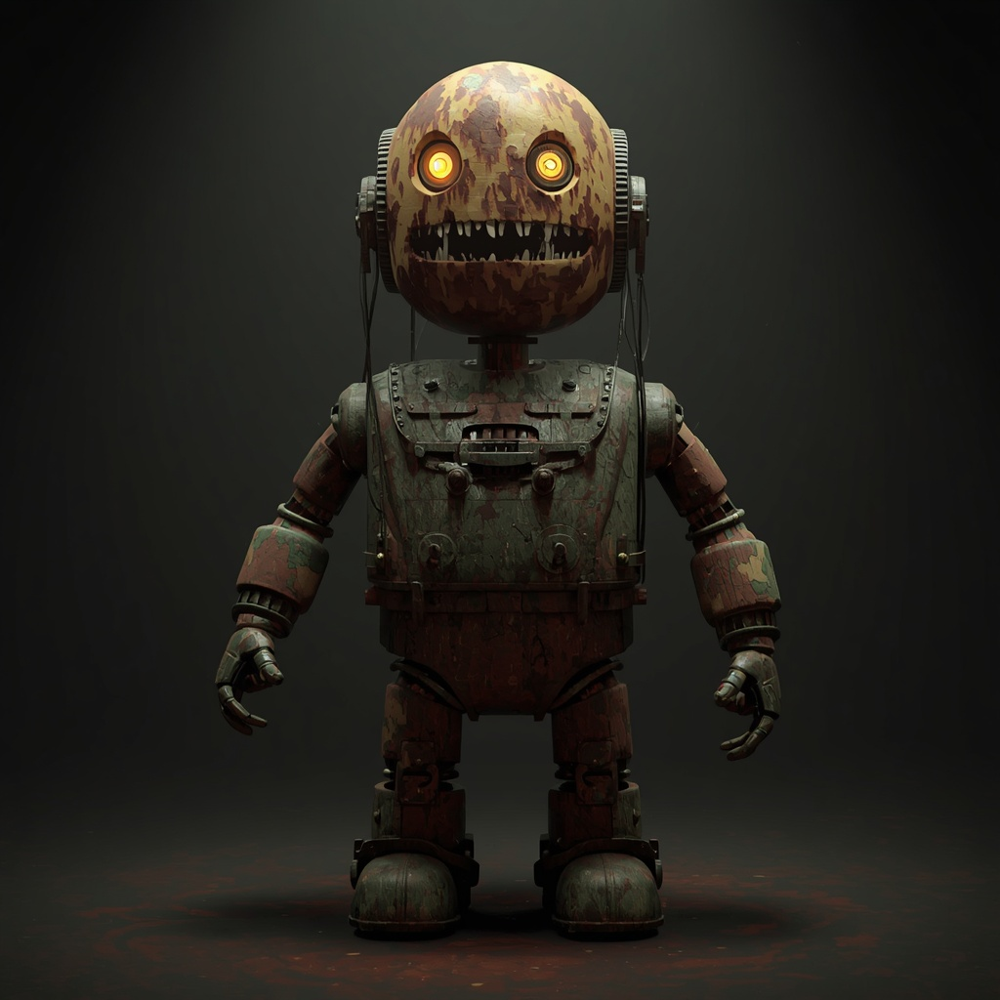
* **Archivo de referencia:** [`Art/ConceptArt/Personajes/concepto_juguete_de_plomo.jpg`](Art/ConceptArt/Personajes/concepto_juguete_de_plomo.jpg)
* **Descripción Visual (Adaptada al estilo *Low-Poly* Animado en Juego):** Autómata de plomo y hojalata de tamaño humano, con pintura descascarada verde y rojiza por la corrosión, cables sueltos en los laterales del cráneo, mandíbula dentada oxidada y ojos circulares que emiten un brillo ámbar eléctrico amenazante.
* **Comportamiento e IA Jugable:**
  * **Origen:** Antiguos prototipos mecánicos desechados décadas atrás en los túneles de ventilación, el Cementerio de Trineos y las cavernas profundas.
  * **Patrullaje y Detección:** Merodean en la oscuridad emitiendo chispas eléctricas y sonidos metálicos de engranajes. Se activan de forma agresiva al detectar el **cono de luz del faro LED del jugador**, el calor de las balizas o el ruido de extracción minera.
  * **Combate y Riesgo:** Atacan cuerpo a cuerpo para dañar la salud del jugador y sabotear la recolección, obligando a usar **Bastones de Menta Curativos**, señuelos luminosos o herramientas reforzadas para neutralizarlos.

---

## 🎮 Jugabilidad y Bucle Principal

El juego combina exploración abierta en un entorno 3D hostil con recolección de recursos, economía y automatización progresiva:

```text
[Explorar Superficie y Cuevas] ➔ [Recolectar y Sobrevivir al Frío] ➔ [Vender en la Aldea] ➔ [Comprar Comida, Equipo y Autómatas] ➔ [Expandir la Red Boreatek]
```

### 1. Exploración en Superficie y Minería Subterránea 3D

Al cruzar las compuertas térmicas de la Aldea de Santa, puedes explorar libremente tanto el exterior nevado como la red de cavernas conectadas bajo tierra:

* **Recursos en la Superficie Ártica:**
  * **Pinos Cristalizados:** Madera densa de los bosques exteriores (*Tundra Exterior Inicial*) utilizada para construir estructuras, postes y soportes.
  * **Trineos Estrellados y Ruinas Polares:** Puntos de interés dispersos en la nieve (*Tundra* y *Cementerio de Trineos*) donde se rescatan piezas mecánicas, chatarra útil y planos antiguos.
  * **Cofres Congelados:** Cajas de suministros bloqueadas por hielo sólido; para abrirlas debes colocar una fuente de calor junto a ellas y esperar a que se derritan.
* **Recursos en el Bosque de Caramelos y Cavernas Profundas (Niveles 1 a 3):**
  * **Carbón Negro:** Combustible básico para hornos, fundidoras y sistemas de calefacción.
  * **Hierro Polar:** Metal azulado/gris oscuro (*Cuevas Nivel 1 y 2*) indispensable para forjar herramientas avanzadas, vagonetas y piezas mecánicas.
  * **Cristal de Caramelo:** Mineral energético rojo brillante (*Bosque de Caramelos* y *Cuevas Nivel 1*) que alimenta la maquinaria festiva y se cotiza a alto precio.
  * **Hielo Azul Profundo:** Ubicado en *La Geoda de Hielo Azul (Nivel 2)*; necesario para enfriar reactores avanzados.
  * **Núcleos Luminosos:** Extraídos en *El Abismo del Núcleo Luminoso (Nivel 3)*; indispensables para los pedidos finales de la campaña de 20 horas.

### 2. Supervivencia Térmica y Peligros

* **Medidor de Temperatura Corporal:** Al salir de la aldea, el viento helado y la **Ventisca Ciega** reducen gradualmente tu calor corporal (especialmente de noche, en el Cementerio de Trineos o en estratos glaciares profundos). Si la barra llega a cero, sufres hipotermia y eres rescatado de vuelta a la base, perdiendo parte de los materiales no asegurados en tu mochila.
* **Guirnaldas Luminosas y Balizas Térmicas:** En lugar de antorchas tradicionales, despliegas cables con focos navideños y balizas térmicas tanto en los senderos nevados como en las paredes de los **Túneles de Ventilación** y cuevas. Iluminan el camino para no perderte en la tormenta y generan **burbujas de calor** para explorar cada vez más lejos.
* **Enemigos del Entorno:**
  * *Juguetes Defectuosos (Soldados de Plomo y Cascanueces Oxidados):* Autómatas desechados con chispas eléctricas que merodean cerca de ruinas exteriores y túneles oscuros, atacando al detectar luz o movimiento.
  * *Gólems de Escarcha:* Guardianes pesados que custodian los yacimientos más valiosos en las zonas profundas (Nivel 2 y Nivel 3) y requieren equipamiento mejorado para ser derrotados.

### 3. Economía y Tienda de la Aldea

Al depositar los materiales recolectados en la tolva central de la **Aldea Industrial de Santa**, obtienes **Monedas de Jengibre / Fichas del Taller** que puedes invertir en cuatro categorías:

* **Comida y Bebidas (Consumibles):**
  * *Termo de chocolate caliente:* Restaura la temperatura corporal al máximo y frena el congelamiento durante 60 segundos (vital durante eventos de *Ventisca Ciega*).
  * *Galleta de jengibre energética:* Aumenta temporalmente la velocidad de movimiento y de recolección.
  * *Bastón de menta curativo:* Recupera salud tras enfrentamientos contra *Soldados de Juguete Defectuosos* y *Gólems de Escarcha*.
* **Herramientas Tácticas:**
  * *Guirnaldas luminosas:* Puntos de luz y calor portátiles para trazar rutas seguras en superficie y bajo tierra.
  * *Petardos festivos:* Explosivos para abrir túneles en roca dura o despejar bloqueos en *La Geoda de Hielo Azul*.
  * *Radar de regalos:* Emite señales acústicas al acercarte a cofres congelados o trineos ocultos en *El Cementerio de Trineos*.
* **Mejoras Permanentes (Equipamiento del Duende Ingeniero):**
  * *Herramientas reforzadas (Pico Industrial con Cristal Energético Rojo y Hacha Polar):* Permiten talar árboles cristalizados/caramelos más densos y romper minerales de mayor dureza (Nivel 2 y Nivel 3).
  * *Tanque-Mochila presurizado de latón con manómetros:* Amplía la capacidad de carga de minerales por expedición antes de volver a la tolva y mejora el monitoreo térmico/energético.
  * *Abrigo térmico acolchado (verde oliva y cuero con forro de borrego) + Botas de nieve:* Reduce de forma permanente la velocidad de congelamiento en la tundra exterior y cuevas profundas.
* **Automatización:**
  * *Duendes mecánicos y cintas transportadoras:* Autómatas que extraen y trasladan recursos automáticamente a través de los túneles de ventilación desde tus puestos de extracción hasta los hornos de la aldea.

### 4. El Evento Final: La Gran Nochebuena (Hito de las 20 Horas)

**La Gran Nochebuena** es el clímax de toda la campaña tras completar las 20 horas de exploración y desbloquear los **Núcleos Luminosos** en las profundidades de Boreatek:

* **Aterrizaje del Trineo Blindado:** El cielo ártico se ilumina con auroras boreales intensas y el trineo de carga principal desciende en la plataforma central de la aldea.
* **Operación a Máxima Capacidad:** Durante esta fase final extensa se activa la cuota definitiva de suministros. Todos los nodos de recursos entran en sobrecarga (soltando el doble de materiales), pero la **Ventisca Ciega** exterior alcanza su punto más crítico, poniendo a prueba toda la red de autómatas, rutas térmicas y mejoras que construiste a lo largo de la partida.

---

## 🛠️ Arquitectura Técnica Base (Unity 3D)

Para implementar el prototipo jugable en Unity con estilo *low-poly* estilizado en URP, el proyecto se estructura en cinco scripts principales en C#:

1. `PlayerController.cs`: Movimiento 3D en primera o tercera persona, desplazamiento sobre terreno nevado, control del faro LED frontal del casco, interacción con objetos y uso de herramientas.
2. `TemperatureSystem.cs`: Controla la pérdida de calor al salir de la zona segura de la Aldea Industrial, el impacto climático de la *Ventisca Ciega*, las bonificaciones del traje térmico y la regeneración cerca de guirnaldas luminosas, balizas o al consumir bebidas calientes.
3. `HarvestableNode.cs`: Gestiona la resistencia de pinos cristalizados, árboles de caramelo gigante, cofres congelados y vetas minerales (Carbón, Hierro Polar, Cristal de Caramelo, Hielo Azul y Núcleos Luminosos), verificando el nivel del pico energético requerido y generando los ítems recolectables.
4. `InventoryAndShop.cs`: Administra los espacios de la mochila metálica, la conversión de materiales en la tolva central a **Monedas de Jengibre / Fichas del Taller** y la compra de consumibles, mejoras permanentes o autómatas.
5. `DayNightCycleManager.cs`: Controla la rotación de la luz direccional (`Directional Light`) en ciclos de 20 minutos reales, activando estados dinámicos de *Ventisca Ciega* y ajustando el frío nocturno hasta alcanzar el evento final de **La Gran Nochebuena**.
