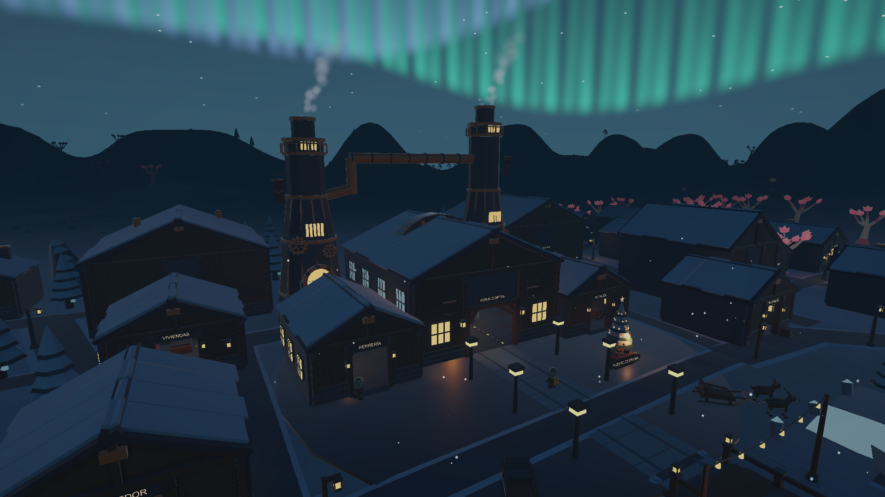
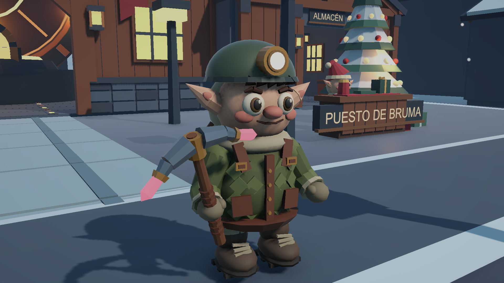
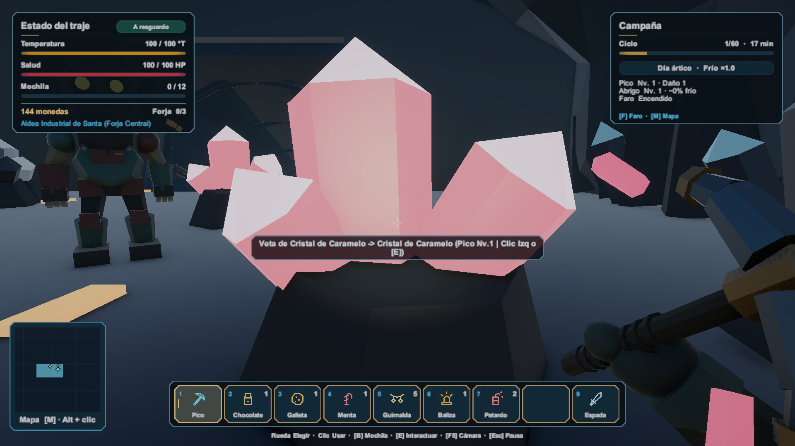
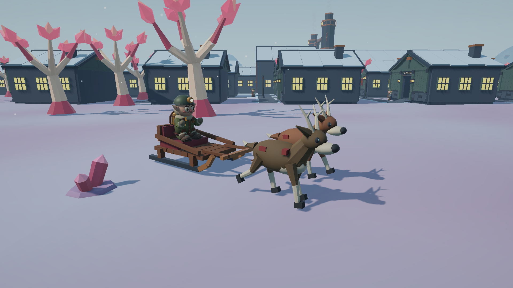
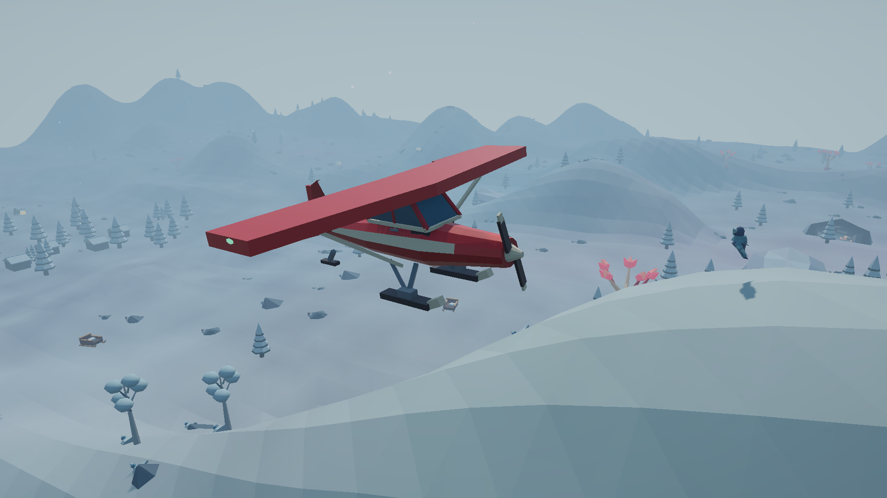

# BOREATEK

**BOREATEK** es un juego de exploración, minería y supervivencia térmica en 3D. Eres un duende ingeniero en la Aldea Industrial de Santa. Para preparar el gran despegue de Nochebuena, tendrás que salir del calor de la forja y buscar núcleos luminosos bajo el hielo.

## Una expedición desde la aldea

Antes de partir, puedes comprar provisiones en el puesto de Bruma. En la tundra, una ventisca puede obligarte a plantar una baliza de calor o a dar media vuelta. Bajo tierra te esperan vetas de cristal y juguetes mecánicos defectuosos. Al regresar, la tolva central cambia tus minerales por monedas de jengibre que puedes invertir en un pico mejor o en autómatas para trabajar las vetas.

| El duende ingeniero en el puesto de Bruma | Extracción de cristal en primera persona |
| --- | --- |
|  |  |

Los trineos de perros y renos permiten cruzar el bosque por tierra. Para explorar más lejos, puedes repostar en el aeródromo de la aldea y sobrevolar las montañas en la avioneta roja.

| En trineo por el bosque de caramelos | En avioneta sobre la tundra |
| --- | --- |
|  |  |

## Tecnologías

- **Unity 6 (`6000.6.0f1`) y C#** para la simulación térmica, el combate, los vehículos y la generación procedural por semilla de biomas y cuevas.
- **Universal Render Pipeline (URP 17.6)** para la iluminación de los escenarios 3D de estilo *low-poly*.
- **Unity Input System y Unity UI (uGUI)** para los controles de teclado, ratón y mando, el inventario y el mapa de expedición.
- **ScriptableObjects** para definir recursos y mejoras. Las partidas se guardan localmente en **JSON**.

[Explorar la documentación de diseño, arte y arquitectura](.docs/README.md)
